

# ✦ Wally

### Your Personal Time Companion

**Trợ lý thời gian cá nhân giúp sinh viên và người đi làm học tập, làm việc có chủ đích hơn — không phải chỉ bận rộn hơn.**

[**Tải APK v2.2.1**](https://github.com/caonguyenthanhan/Time_Wallet/releases/tag/v2.2.1) · [**Xem giao diện**](#-trải-nghiệm-thực-tế) · [**Một ngày cùng Wally**](#-một-ngày-cùng-wally) · [**Tài liệu kỹ thuật**](docs/ARCHITECTURE_AND_PRIVACY.md)

---

**Time Wallet (`Wally`)** gộp lịch trình 24 giờ, công việc To-do, bấm giờ tập trung và trợ lý AI vào một nhịp sử dụng nhẹ nhàng: bạn biết rõ *mình đang làm gì, sắp làm gì, còn bao nhiêu thời gian trống* — cả bên trong ứng dụng lẫn qua **Widget màn hình chính** và **Trợ lý nổi Wally**. Mọi gợi ý đều minh bạch, không phán xét và **chỉ lưu vào lịch khi bạn bấm xác nhận**.

---

## Trải nghiệm thực tế

  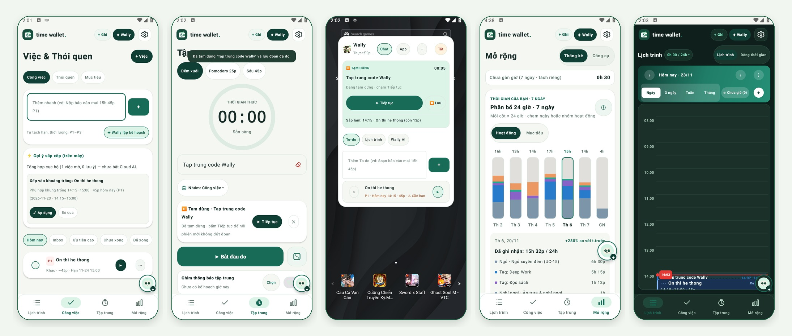

| Lịch trình trực quan | AI To-do thông minh | Trợ lý nổi trên màn hình | Thống kê 24 giờ trung thực |
| :---: | :---: | :---: | :---: |
| 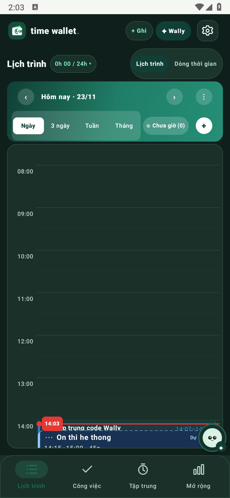 | 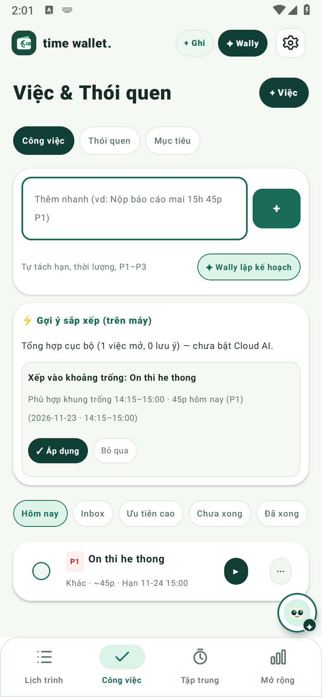 | 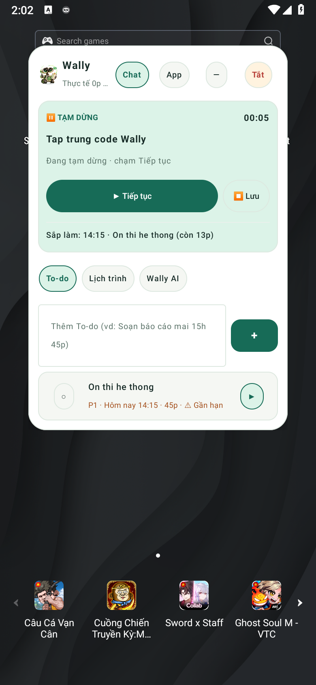 | 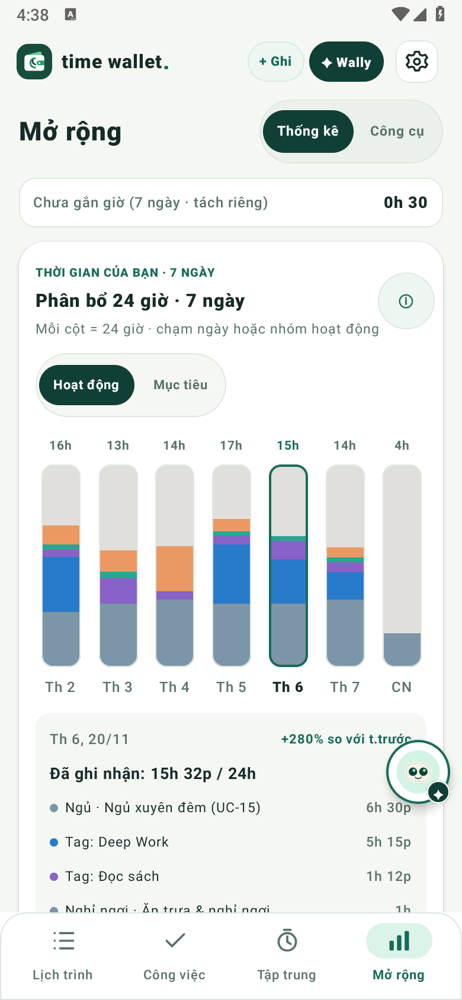 |
| Phân biệt việc đã đo thực tế & kế hoạch dự kiến | Nhập câu tự nhiên, Wally gợi ý giờ trống để duyệt | Theo dõi Đang làm, Sắp làm, To-do ngay ngoài app | Nhìn trọn phân bổ 7 ngày & nhịp học/làm việc |

---

## Một ngày cùng Wally

| 1. Lên kế hoạch nhẹ đầu ngày | 2. Tập trung không đứt mạch | 3. Nhìn lại có chủ đích |
| :--- | :--- | :--- |
| Gõ tự nhiên *"Ôn thi hệ thống hôm nay 15h 45p P1"* — Wally tự tách hạn, thời lượng, mức ưu tiên, tìm khoảng trống hợp lệ và chờ bạn bấm **Áp dụng**. | Bắt đầu phiên đo từ tab **Tập trung**, **Widget** hay **Bảng nhanh nổi**. Khi cần nghỉ ngang, bấm **Tạm dừng** để lưu đoạn vừa đo rồi **Tiếp tục** nối phiên bất cứ lúc nào. | Cuối ngày xem 24 giờ đã đi đâu trên **Lịch trình**, kiểm tra tiến độ **Thói quen / Mục tiêu** và đọc tóm tắt từ dữ liệu thực — không áp lực hay phỏng đoán. |

---

## Wally AI làm được gì?

| Hỏi lịch & sắp xếp ngay trên màn hình | Xử lý To-do theo ngữ cảnh thật |
| :---: | :---: |
| 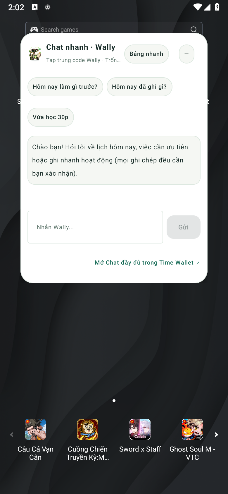 | 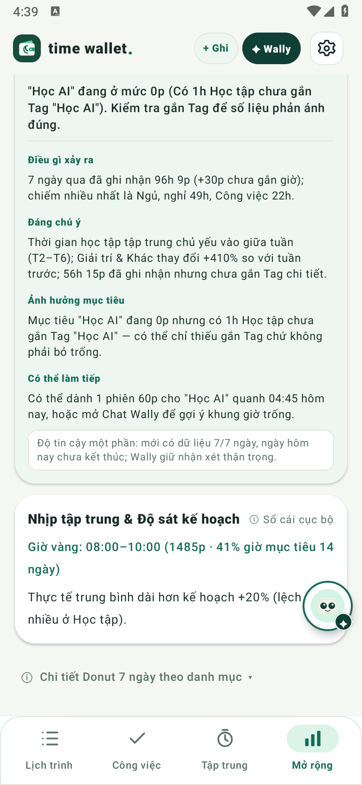 |
| Chạm bóng Wally nổi để hỏi *"Hôm nay làm gì trước?"*, *"Ghi vừa học 30p"* hay nhắn tự nhiên mà không cần rời app đang dùng. | Wally chỉ ra khối lượng quá tải, việc sắp trễ hạn hoặc khung giờ trống phù hợp dựa trên dữ liệu bạn cho phép đọc. |

**Những tình huống hằng ngày với sinh viên & người đi làm:**
- *"Tôi có 2 tiếng trống buổi tối và 3 việc To-do, nên làm gì trước?"* → Wally phân tích hạn chót, ưu tiên và đề xuất thứ tự kèm khung giờ đặt vào lịch.
- *"Ôn tập giải tích 45p, chia nhỏ giúp tôi."* → Gợi ý chia bước nhỏ để bạn tick dần mà không ngại bắt đầu.
- *"Hôm nay tôi đã dành bao nhiêu giờ cho học tập?"* → Trả lời đúng phần đã ghi nhận thực tế, tách bạch rõ với lịch dự kiến (`PLANNED`).

> **Nguyên tắc vàng:** Wally AI **chỉ đề xuất** — không bao giờ tự thêm, sửa hay xóa dữ liệu của bạn khi chưa được bấm **✓ Xác nhận**. Khi không dùng Cloud AI, các phân tích nhịp độ & cảnh báo trễ hạn vẫn chạy hoàn toàn cục bộ trên máy.

---

## Các chức năng chính

<table>
  <tr>
    <td width="33%" valign="top">
      <strong>📅 Lịch trình 24 giờ & Thời gian trống</strong> 
      Xem theo Ngày, 3 ngày, Tuần, Tháng; chạm/kéo chọn khoảng trống để lên lịch nhanh hoặc chuyển việc chưa gắn giờ vào đúng khung rảnh.
    </td>
    <td width="33%" valign="top">
      <strong>✅ AI To-do, Thói quen & Mục tiêu</strong> 
      Quản lý To-do kèm checklist con, cảnh báo trùng lịch & gần hạn, chuỗi thói quen 7 ngày, Kanban, ma trận Eisenhower và mục tiêu ngày/tuần.
    </td>
    <td width="33%" valign="top">
      <strong>⏱️ Tập trung & Ghim Focus</strong> 
      Đếm xuôi hoặc Pomodoro 25p/45p, hỗ trợ Tạm dừng & Tiếp tục không mất thời gian đã đo, kèm thông báo ghim Focus cố định và xúc xắc gợi ý phiên.
    </td>
  </tr>
  <tr>
    <td width="33%" valign="top">
      <strong>🧩 Widget màn hình chính</strong> 
      Hỗ trợ nhiều kích thước thẻ bo góc hiển thị Đang làm, Sắp làm, Lịch trình, To-do (tick hoàn thành / bấm đo nhanh) và gợi ý ngắn.
    </td>
    <td width="33%" valign="top">
      <strong>✨ Trợ lý nổi Wally</strong> 
      Mascot nổi gọn nhẹ trên màn hình Android: chạm mở Chat nhanh, nhấn giữ mở Bảng điều khiển nhanh, kéo đặt cạnh viền hoặc tắt bất cứ lúc nào.
    </td>
    <td width="33%" valign="top">
      <strong>🌗 Dark Mode, Cỡ chữ & Sao lưu</strong> 
      Giao diện Sáng / Tối dịu mắt, chọn cỡ chữ 3 mức, tự kiểm tra bản mới qua GitHub, xuất báo cáo Markdown sang Obsidian và sao lưu JSON.
    </td>
  </tr>
</table>

<strong>Xem thêm ảnh chụp màn hình v2.2.1 (Wally kể từ dữ liệu &amp; Căn cứ) và Light / Dark</strong>

 

| Wally kể từ dữ liệu (`v2.2.1`) | Phân tích &amp; Căn cứ (`v2.2.1`) | Nhịp tập trung &amp; Lịch trình | Tập trung Tạm dừng | Trợ lý nổi |
| :---: | :---: | :---: | :---: | :---: |
| 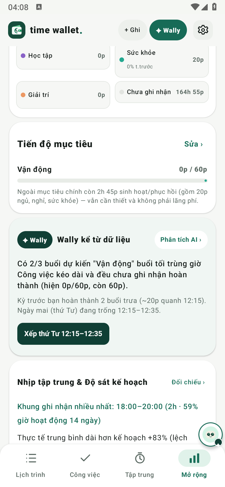 | 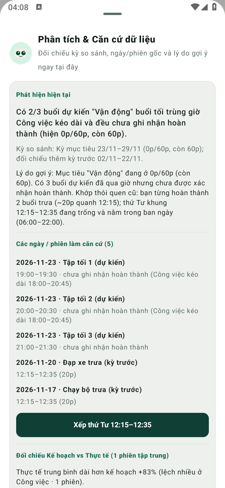 | 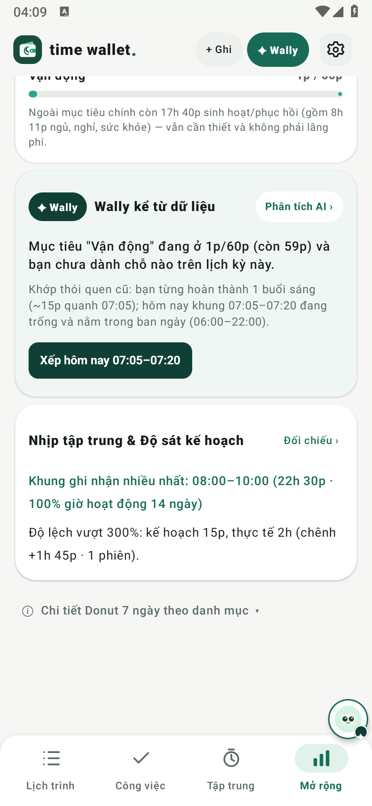 | 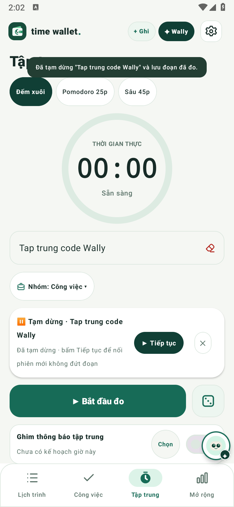 | 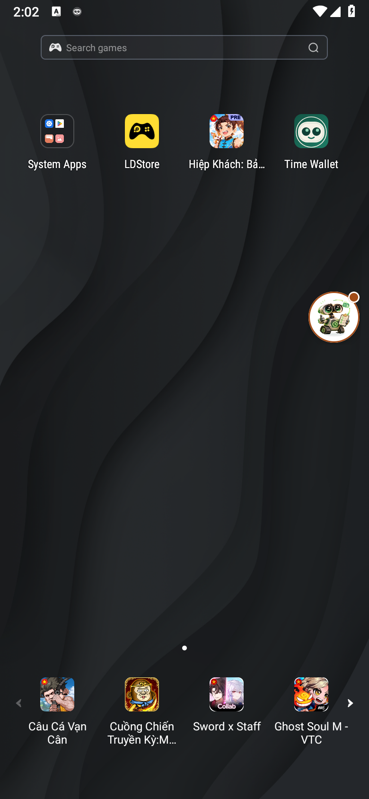 |

👉 Xem toàn bộ thư viện ảnh và chú thích kiểm chứng chi tiết tại **[docs/screenshots/ui-preview/README.md](docs/screenshots/ui-preview/README.md)**.

---

## Tải và cài đặt

1. Tải tệp **`TimeWallet-MVP-v2.2.1-release.apk`** từ trang **[GitHub Releases v2.2.1](https://github.com/caonguyenthanhan/Time_Wallet/releases/tag/v2.2.1)** (`Android 8.0+`).
2. Mở tệp `.apk` vừa tải và cho phép cài đặt từ trình duyệt / trình quản lý tệp.
   *(Nếu lần đầu cài APK ngoài Play Store và Android / Play Protect hỏi xác nhận, chọn **"Vẫn cài đặt"** hoặc xem mã `SHA-256` kèm theo trên trang Release để tự đối chiếu.)*
3. Nếu đã cài các bản Release trước (`v2.0.0` – `v2.2.0`), bạn có thể cài đè trực tiếp hoặc cập nhật ngay bên trong **⚙ Hồ sơ & Cài đặt** mà không mất dữ liệu lịch, To-do hay khóa AI đã lưu.

> **Muốn dùng AI Cloud:** vào **⚙ Hồ sơ & Cài đặt › Cấu hình Wally AI** để nhập API key riêng của bạn (hỗ trợ OpenAI-compatible, Gemini, Claude, Groq, Ollama...). Toàn bộ tính năng Lịch trình, Tập trung, To-do, Widget và Trợ lý nổi vẫn dùng bình thường ngay cả khi ngoại tuyến.

---

## Quyền riêng tư & Tài liệu kỹ thuật

- **Dữ liệu ở trên máy:** nhật ký thời gian, To-do, mục tiêu và thói quen lưu hoàn toàn cục bộ trên điện thoại; không tài khoản bắt buộc, không theo dõi người dùng.
- **Không đọc trộm màn hình:** Trợ lý nổi chỉ hiển thị lớp phủ khi bạn bật; ứng dụng không dùng quyền Trợ năng (`Accessibility`) để đọc nội dung ứng dụng khác.
- **Kiểm soát quyền đọc cho AI:** bật hoặc tắt từng mảng dữ liệu (Sổ cái, Công việc, Thói quen, Mục tiêu) ngay trong phần Cài đặt.
- **Minh bạch mã nguồn & xác thực cập nhật:** mỗi bản phát hành đều đính kèm tệp `.sha256` và được ứng dụng kiểm tra chữ ký số trước khi cài đè.

<strong>Dành cho nhà phát triển & Tài liệu chuyên sâu</strong>

- **[Kiến trúc, Quyền riêng tư & Kết quả kiểm chứng v2.2.1](docs/ARCHITECTURE_AND_PRIVACY.md)** — Mô tả chi tiết 4 tầng dữ liệu, Room Database, quy chế bảo mật khóa API, kết quả test/lint/QA và hướng dẫn build Gradle.
- **[Đặc tả sản phẩm Time Wallet & Wally](SPEC_TIME_WALLET_WALLY.md)** — Triết lý thiết kế và các bất biến nghiệp vụ cốt lõi.
- **[Thư viện ảnh giao diện ui-preview](docs/screenshots/ui-preview/README.md)** — Toàn bộ ảnh chụp kiểm chứng thực tế qua từng phiên bản.

