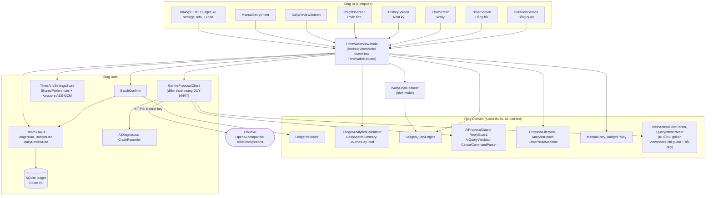
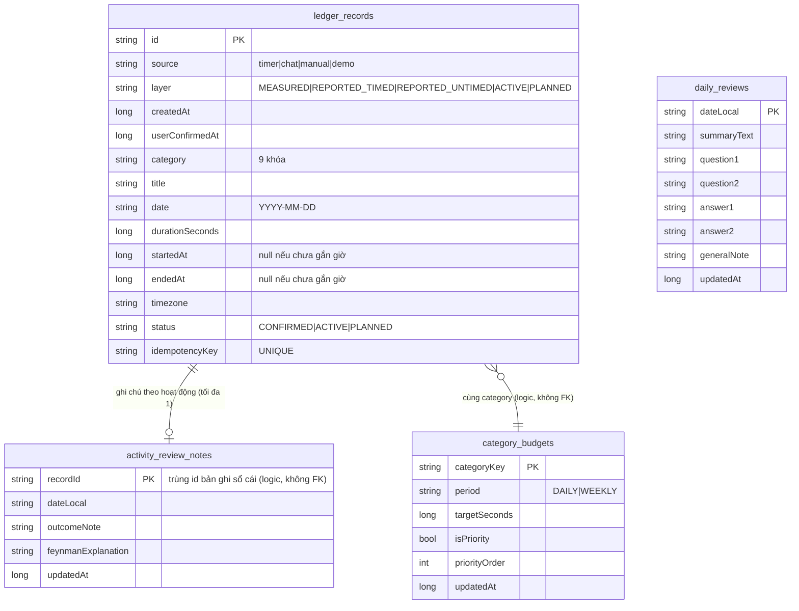
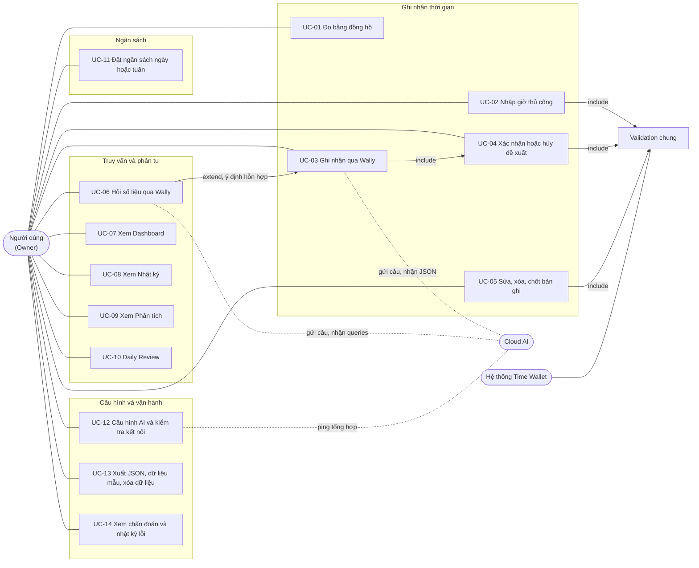
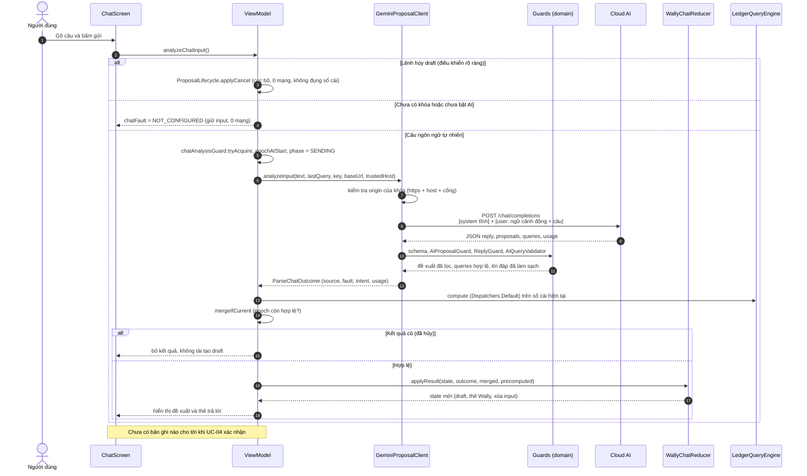
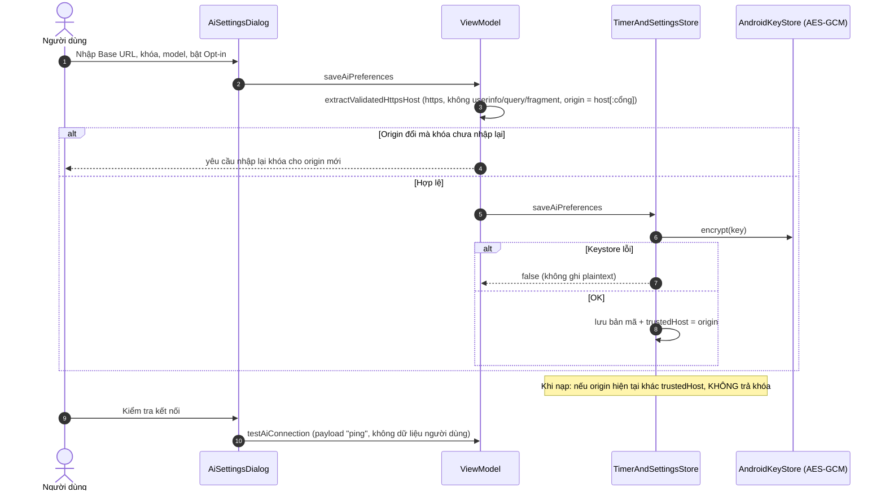
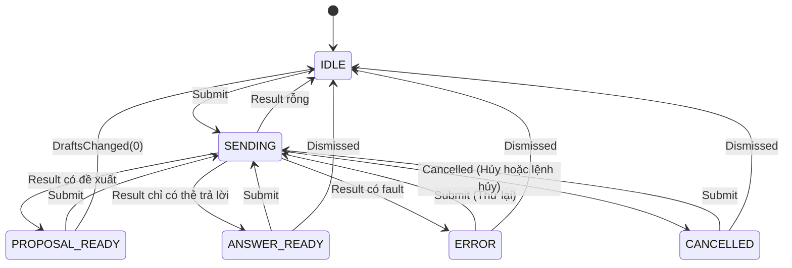

# TIME WALLET / WALLY — ĐẶC TẢ KỸ THUẬT (Diagram, Use Case, Action Case)

**Phiên bản mô tả:** candidate v1.0.7 (`versionCode 8`, package `com.timewallet.mvp`; mô tả v1.0.6/`versionCode 7` được giữ ở các đính chính dưới) · Android, Kotlin, Jetpack Compose, Room v3 · Ngày: 2026-11-14 (cập nhật từ bản mô tả v1.0.5 sau Review độc lập; các đính chính ở khung dưới)
**Trạng thái:** CANDIDATE_UNVERIFIED. F6 (app dừng đột ngột) UNRESOLVED. Chưa chạy trên thiết bị thật, chưa gọi AI thật.
**Cách đọc:** sơ đồ viết bằng Mermaid (xem được trong VS Code, GitHub). Mỗi mục kỹ thuật ghi tên file/hàm thật. Nhãn kiểm chứng: **[JVM]** có test chạy, **[MOCK]** có test với HTTP giả, **[TĨNH]** chỉ kiểm tra tĩnh mã nguồn, **[CHƯA]** chưa kiểm chứng trên thiết bị hoặc AI thật.

> **Đính chính so với bản mô tả v1.0.5 (Review `REVIEW_WALLY_V105.md`, sửa trong v1.0.6):**
> 1. **Timer > 24h không còn "chỉ Hủy":** phiên được cắt thành các đoạn liên tiếp ≤ 24h theo thời gian thực và ghi trong MỘT giao dịch (UC-01, §6.3). Trùng giờ ⇒ giữ phiên để sửa rồi lưu lại.
> 2. **Khóa API:** không còn khóa dự phòng trong RAM. Keystore lỗi ⇒ **không lưu** (báo rõ) và giữ nguyên cấu hình cũ; khi nạp ⇒ `keyUnavailable`. (Bản v1.0.5 mô tả đúng ý định nhưng mã thực tế vẫn dùng khóa RAM và báo "đã lưu".) Keystore thật trên thiết bị vẫn **[CHƯA]** kiểm chứng; sửa Keystore **không** đồng nghĩa đã sửa crash F6.
> 3. **Ngân sách:** một định nghĩa duy nhất cho mọi màn hình — *đã ghi nhận = có mốc giờ + chưa gắn giờ, không PLANNED* (§3.2, AC-B04). Wally trả lời được câu hỏi ngân sách bằng metric `BUDGET` (một vòng AI, số tính trên máy).
> 4. **Hợp đồng phản hồi AI chặt (§8.2–8.3):** sai kiểu/`null`/JSON cắt hoặc thừa ⇒ `MALFORMED`; lời đáp AI không được báo đã ghi/sửa/xóa và không được nêu số liệu cá nhân (chữ số, số bằng chữ, %); số chỉ đến từ `LedgerQueryEngine`. Prompt nâng lên `wally-prompt-4`.
> 5. **Tổng ngày > 24h:** Dashboard CÓ cảnh báo (không chỉ kẹp thanh tiến độ) và không chặn nhập; cảnh báo nói rõ phần chưa gắn giờ có thể trùng phần có mốc giờ.
> 6. **Phân tích chat theo "vé" sở hữu (§5.3):** Hủy rồi Gửi lại không mất cú chạm; lượt cũ không ghi đè trạng thái hay nhả quyền của lượt mới; số liệu tính ngoài luồng chính.
> 7. **Số liệu kiểm chứng:** bản v1.0.5 có 222 test trong cây + 2 test ngoài cây (harness holdout) = 224 (manifest nguồn của v1.0.5 có **85** dòng, không phải 81). Bản v1.0.6: **322** test trong cây + 2 ngoài cây = **324** (manifest nguồn **101** dòng).

> **Đính chính v1.0.7 (3 finding còn mở sau Review v1.0.6; chỉ các thay đổi sau, kiến trúc API-first / 8 tầng / origin binding / quyền riêng tư giữ nguyên):**
> 1. **`F-V105-03` — phủ định với số bằng chữ tiếng Việt (§8.3):** `VietnameseChatParser.normalizeSpelledDurations` chuẩn hóa số bằng chữ (1–999, "nửa tiếng", "một tiếng rưỡi", "hai phẩy năm giờ", "hai mươi lăm phút", "14 giờ hai mươi lăm") thành chữ số trước khi tách mệnh đề; tránh nhầm số thứ tự ("thứ hai", "tháng năm") và "tiếng Anh/Việt". Câu có phủ định đứng trước thời lượng **mơ hồ** ("vài tiếng", "mấy giờ"), hoặc một từ phủ định nối chung thời lượng bằng "và/hay" không tách được mệnh đề khẳng định/phủ định ⇒ **không tạo đề xuất và yêu cầu làm rõ**. "Không nghỉ", cùng thời lượng ("không học hai tiếng nhưng làm việc hai tiếng") và câu hỗn hợp giữ đúng phần khẳng định.
> 2. **`V106-N1` — AI không được tuyên bố đã lưu trước commit (§8.3):** (a) luồng ghi nhận thuần (có đề xuất chờ xác nhận, không có truy vấn) **không hiển thị lời đáp tự do của AI**; ứng dụng dùng thẻ đề xuất/toast trạng thái do chính nó tạo; (b) lời đáp chỉ-AI (không đề xuất, không truy vấn) luôn kèm một dòng trạng thái **do ứng dụng tạo** ("Chưa có gì được lưu. Còn N đề xuất đang chờ bạn xác nhận." hoặc, khi câu của người dùng có thời lượng mà AI không tạo đề xuất, "Chưa có gì được lưu: Wally chưa tạo đề xuất ghi nhận nào từ câu này…") — phòng thủ cấu trúc, không phụ thuộc regex; (c) `ReplyGuard` mở rộng bắt các cách nói gián tiếp ("đã tự động hoàn tất", "giữ giúp bạn rồi", "đã vào danh sách", "có mặt trong Nhật ký", "Sổ cái đã nhận", "đã chép vào sổ", "note lại rồi", "sẵn sàng trong sổ"…). `ReplyGuard` vẫn là heuristic: không thể liệt kê mọi cách diễn đạt; dòng trạng thái ở (b) mới là bảo đảm cấu trúc.
> 3. **`V106-N2` — BOM và bảo toàn thời lượng:** `\uFEFF` dẫn đầu được bỏ **trước** mọi kiểm tra JSON (envelope, `content`, khối fence, `usage`); `\uFEFF[1, 2]`/`\uFEFFnull` ⇒ `MALFORMED` (không còn lọt thành lời đáp). `TimerCommit` quy phiên về số giây nguyên theo quy ước **làm tròn xuống** (`floor((end−start)/1000)`), phiên dưới 1 giây bị từ chối (không phình thành 1 giây), tổng các đoạn luôn đúng bằng số giây đó. `LedgerAnalyticsCalculator.computeDayStats` cộng theo mili-giây rồi mới quy đổi giây (sweep-line + phân bổ phần dư theo danh mục), nên các mảnh dưới 1 giây không còn làm mất giây tích lũy và một bản ghi vắt qua nửa đêm cộng đúng tổng giữa các ngày; dữ liệu tròn giây không đổi kết quả.
> **Đính chính v1.0.8 (V106-N1 đóng theo kiến trúc; V107-F1/F2):** trạng thái giao dịch do **ứng dụng** phát ngôn qua `WallyTurnPolicy` — RECORD và MIXED có đề xuất: bỏ hoàn toàn lời đáp tự do của AI (MIXED giữ truy vấn, số liệu do engine tính, kèm dòng "số liệu chỉ gồm bản ghi đã lưu"); lượt chat liên quan ghi nhận / hỏi "đã lưu chưa" / còn đề xuất chờ: thẻ do ứng dụng tạo là headline ("Chưa có gì được lưu…"), lời AI không hiển thị; hội thoại không liên quan giao dịch giữ nguyên lời AI. Thẻ trạng thái bị xóa khi danh sách đề xuất đổi. Thẻ đề xuất ghi rõ "chờ bạn xác nhận / Chưa lưu vào sổ". Số liệu v1.0.8: **357** test trong cây + 2 ngoài cây = **359** PASS (manifest nguồn **105** dòng). Chi tiết: `WALLY_V108_DOSSIER.md`.
> 4. **Số liệu kiểm chứng v1.0.7:** **341** test trong cây + 2 ngoài cây = **343** PASS (manifest nguồn **103** dòng).

---

## 1. Bất biến sản phẩm

| # | Bất biến | Thực thi |
|---|---|---|
| I1 | Chỉ bản ghi **hợp lệ đã commit** mới vào tổng số. | `LedgerValidator` + `LedgerDao.commit*` |
| I2 | Thời lượng **không có mốc giờ** không được đưa vào chỉ số trục giờ; không tự suy ra giờ bắt đầu/kết thúc. | `LedgerAnalyticsCalculator.computeDayStats` (timed/untimed tách riêng) |
| I3 | **Thời gian dự kiến (PLANNED)** không phải thời gian đã dùng. | `TimeLayer.PLANNED`, `DashboardSummary` |
| I4 | AI **chỉ đề xuất hoặc trả lời**; mọi ghi dữ liệu qua validation và **xác nhận của người dùng**. | `GeminiProposalClient` không có DAO; `BatchConfirm.run` |
| I5 | Khóa API do người dùng nhập, lưu bằng Android Keystore, gắn với **origin**, không rời máy sang origin khác. | `AesGcmKeystoreVault`, `AiPreferences`, `GeminiProposalClient.postJson` |
| I6 | Manual, Timer, Nhật ký, Ngân sách, Dashboard chạy **offline**, không cần khóa API. | không phụ thuộc `aiPreferences` |
| I7 | Mọi tin nhắn ngôn ngữ tự nhiên ở tab Wally đi qua **Cloud AI** (API-first); không chatbot cục bộ. | `TimeWalletViewModel.analyzeChatInput` |

---

## 2. Kiến trúc tổng thể



**Quy ước phân tầng:** domain không import Android/Room/mạng (có test tĩnh). Chỉ `GeminiProposalClient` mở kết nối và đặt `Authorization`. Mọi đường GHI từ đề xuất hoặc nhập thủ công đi qua `BatchConfirm.run`.

### 2.1 Điều hướng

| Tab (`AppTab`) | Nhãn | Màn hình | FAB "＋" |
|---|---|---|---|
| OVERVIEW | Tổng quan | `OverviewScreen` hoặc `DailyReviewScreen` (không có route riêng, cờ `isShowingDailyReview`) | Có (trừ Daily Review) |
| TIMER | Đồng hồ | `TimerScreen` | Không |
| CHAT | Wally | `ChatScreen` | Không |
| HISTORY | Nhật ký | `HistoryScreen` | Có |
| INSIGHTS | Phân tích | `InsightsScreen` | Không |

Không có màn hình Settings riêng: cấu hình AI mở từ chip "⚙" trong tab Wally; thông tin, nhật ký lỗi mở từ nút ⓘ; xuất JSON từ nút ⇩ ở thanh trên.

---

## 3. Mô hình dữ liệu



- **Chỉ mục:** `idempotencyKey` UNIQUE, `date`, `(startedAt, endedAt)`. Schema v3, `exportSchema=false`, migration 1→2→3 không phá hủy; không có `fallbackToDestructiveMigration`.
- **Không có cột ghi chú:** ghi chú nhập thủ công được lưu vào `title` (tối đa 110 ký tự; để trống thì dùng tên danh mục). Nhờ vậy không cần migration.
- **Một ngân sách mỗi danh mục** (`categoryKey` là khóa chính); tối đa 3 ngân sách ưu tiên (`BudgetPolicy`). Giới hạn mục tiêu: DAILY ≤ 24h, WEEKLY ≤ 7×24h.
- **9 danh mục (`TimeCategory`):** work, learn, health, life, rest, social, fun, sleep, other.

### 3.1 Vòng đời lớp thời gian của một bản ghi

```mermaid
stateDiagram-v2
  [*] --> MEASURED: Đồng hồ dừng và lưu
  [*] --> REPORTED_TIMED: Nhập có giờ bắt đầu và kết thúc, đã qua
  [*] --> REPORTED_UNTIMED: Chỉ có thời lượng (Manual, Wally)
  [*] --> PLANNED: Ngày hoặc giờ ở tương lai
  [*] --> ACTIVE: Đang diễn ra (đã bắt đầu, chưa kết thúc)
  ACTIVE --> REPORTED_TIMED: Chốt thực tế (confirmPlannedOrActiveRecord)
  PLANNED --> REPORTED_TIMED: Chốt thực tế
  REPORTED_UNTIMED --> REPORTED_TIMED: Sửa, thêm giờ (saveEditedRecord)
  note right of PLANNED: Không tính vào đã dùng
  note right of REPORTED_UNTIMED: Tổng theo ngày OK; KHÔNG vào trục giờ
```



### 3.2 Quy tắc `LedgerValidator`

| Quy tắc | Giá trị / hành vi | Thông điệp chính |
|---|---|---|
| Tên | không rỗng | "Hãy nhập tên hoạt động." |
| Danh mục | một trong 9 khóa | "Danh mục '…' không nằm trong danh sách cho phép." |
| Ngày | `YYYY-MM-DD` hợp lệ; ngày tương lai ⇒ PLANNED | "Ngày thực hiện không hợp lệ" |
| Giờ | có cả bắt đầu và kết thúc, hoặc bỏ trống cả hai; kết thúc ≤ bắt đầu ⇒ qua ngày hôm sau; chỉ thời lượng: 1..1440 phút | "Hãy nhập cả giờ bắt đầu và giờ kết thúc…", "Thời lượng phải từ 1 đến 1440 phút." |
| Độ dài | một bản ghi ≤ 24h | "Một bản ghi đơn lẻ không vượt quá 24 giờ." |
| Khớp giờ | thời lượng khai báo lệch khoảng giờ > 2 phút (nguồn không phải timer) bị từ chối | "Mốc giờ tương ứng X phút, không khớp với Y phút đã nhập." |
| Chồng lấn | giữa các bản ghi **có mốc giờ**, bỏ qua PLANNED | `Bị trùng mốc giờ thực tế với "…"` |
| Timer đang chạy | bản ghi có giờ chồng timer bị chặn; bản ghi chỉ thời lượng thì không | "Bộ đếm đang chạy (…)" |
| Lô (batch) | **All-or-Nothing**: một mục sai thì cả lô không ghi | "Mục #n (…): …" |
| Trùng key | cùng `idempotencyKey` ⇒ bỏ qua, không ghi đôi | (đếm `skippedDuplicates`) |

Không có trần tổng 24h theo ngày và **không chặn cứng** việc nhập thêm thời lượng chưa gắn giờ: tổng "đã ghi nhận" có thể vượt 24h. Dashboard kẹp thanh tiến độ, không hiện số âm và **hiện cảnh báo** ("Tổng đã ghi nhận (có mốc giờ + chưa gắn giờ) vượt quá độ dài của ngày. Phần chưa gắn giờ có thể trùng với phần có mốc giờ…"). **Đã ghi nhận = có mốc giờ + chưa gắn giờ (không PLANNED)** dùng thống nhất ở hero/donut, Ngân sách, Insights, Nhật ký ngày và Wally; trục 24h, biểu đồ 7 ngày và `untrackedPast` chỉ gồm phần có mốc giờ và được ghi rõ như vậy.

---

## 4. Use case

### 4.1 Sơ đồ use case



### 4.2 Bảng use case

| ID | Tên | Actor | Tiền điều kiện | Luồng chính | Luồng thay thế / lỗi | Hậu điều kiện | Mã & kiểm chứng |
|---|---|---|---|---|---|---|---|
| **UC-01** | Đo bằng đồng hồ | Người dùng | Chưa có timer chạy; tên hoạt động không rỗng | 1) Chọn danh mục, nhập tên. 2) **Bắt đầu**: lưu `ActiveTimerSession` (epoch, elapsedRealtime, boot count). 3) **Dừng và lưu**: tính thời gian đã trôi (phân biệt cùng lần khởi động, lệch đồng hồ); `TimerCommit.run` cắt phiên thành các đoạn ≤ 24h (`TimerSegments.split`, theo thời gian thực nên an toàn với ngày DST 23h/25h), mỗi đoạn qua `validateAndBuildRecord` nguồn `timer`, múi giờ của phiên, key `timer_<startMs>` (đoạn 0, trùng khóa v1.0.5) và `timer_<startMs>_<i>`, ghi bằng `commitBatchRecordsGuarded` (một giao dịch) | Tên rỗng ⇒ toast. Chạy < 1 giây ⇒ không lưu. Trùng giờ ⇒ toast **và phiên được giữ** để sửa/xóa bản ghi trùng rồi lưu lại (không buộc Hủy). Phiên > 24h ⇒ nhiều bản ghi liên tiếp, tổng đúng bằng cả phiên. App tắt giữa lúc ghi xong và lúc xóa phiên ⇒ khi mở lại phát hiện khóa `timer_<startMs>` đã có và chỉ dọn phiên (không ghi trùng) | Bản ghi MEASURED; xóa timer; về tab Tổng quan | `startTimer`, `stopAndSaveTimer`, `cancelRunningTimer`; `TimeWalletDomainTest` [JVM]; hành vi nền/khởi động lại [CHƯA] |
| **UC-02** | Nhập giờ thủ công | Người dùng | Không cần AI hay khóa | 1) FAB "＋" hoặc "Thêm giờ" mở sheet (sinh `sessionId` một lần). 2) Chọn danh mục; chọn nhanh 15p/30p/1h/2h hoặc nhập giờ/phút; chọn ngày (Hôm nay, Hôm qua, hoặc lịch ≤ hôm nay); ghi chú tùy chọn. 3) **Lưu**: `ManualEntry.validate` → `BatchConfirm.run` (id/key = `manual_<sessionId>`) | Dữ liệu sai ⇒ lỗi hiện trong sheet, giữ form. Bấm Lưu lặp ⇒ 1 bản ghi (cờ `saving`, `manualSaveGuard`, trùng key). Ngày tương lai bị từ chối. Timer đang chạy không chặn (không có giờ) | Bản ghi `REPORTED_UNTIMED`, nguồn `manual`, không có start/end; Dashboard, Nhật ký, Phân tích, Ngân sách cập nhật | `ManualEntry.kt`, `ManualEntrySheet.kt`, `saveManualEntry`; `WallyManualEntryTest` [JVM]; giao diện [TĨNH] |
| **UC-03** | Ghi nhận qua Wally | Người dùng, Cloud AI | AI đã cấu hình và bật; có mạng | 1) Gõ câu (ví dụ "Học 45p"). 2) Hệ thống gửi **mọi** câu tới API. 3) AI trả `reply/proposals/queries`. 4) Schema, nghiệp vụ, guard. 5) Hiện đề xuất (draft) + thẻ trả lời. Chưa có gì được ghi | Chưa cấu hình ⇒ hướng dẫn, 0 kết nối. Lỗi mạng/HTTP ⇒ banner lỗi, giữ input, Thử lại/Ghi thủ công. Phủ định, sửa lại thời lượng ⇒ không đề xuất. Lệnh hủy ⇒ UC-04 | Draft trong RAM (tối đa 15), `needsConfirmation=true` | `analyzeChatInput`, `GeminiProposalClient`, `WallyChatReducer`; `WallyAiFaultInjectionTest`, `WallyApiFirstContractTest` [MOCK]; AI thật [CHƯA] |
| **UC-04** | Xác nhận hoặc hủy đề xuất | Người dùng | Có ≥1 draft | **Xác nhận** (từng cái hoặc "Xác nhận toàn bộ"): `BatchConfirm.run` (All-or-Nothing, kiểm tra lại timer trong khóa). **Hủy**: "Bỏ hết", bỏ từng draft, hoặc gõ lệnh ("Hủy tất cả đề xuất", "Hủy đề xuất số 2", "Hủy ghi nhận 30 phút đọc sách") | Lô không hợp lệ/trùng giờ ⇒ không ghi gì, toast lý do. Bấm xác nhận lặp ⇒ `confirmGuard` + key ⇒ không ghi đôi. Lệnh mơ hồ ⇒ hỏi lại, không hủy. Hủy khi đang phân tích ⇒ kết quả muộn bị bỏ | Bản ghi nguồn `chat` (REPORTED_TIMED/UNTIMED/PLANNED); draft bị xóa. Lệnh hủy **không** đụng sổ cái | `confirmProposalsList`, `ProposalLifecycle`; `Ai01ClosureLifecycleTest`, `WallyEightLayerTest` [JVM] |
| **UC-05** | Sửa, xóa, chốt bản ghi | Người dùng | Bản ghi tồn tại (Nhật ký) | **Sửa**: chạm dòng hoặc ✎, `saveEditedRecord` (cùng validator, cập nhật nguyên bản ghi). **Xóa**: × rồi xác nhận, `deleteRecord` trong **một giao dịch Room** cùng ghi chú liên quan. **Chốt thực tế**: `confirmPlannedOrActiveRecord` | Vi phạm validator ⇒ toast, không đổi. Không có hoàn tác sau xóa | Tổng cập nhật từ cùng nguồn dữ liệu | `ComponentsAndDialogs.EditRecordDialog`; hoàn tác giao dịch Room [TĨNH], thiết bị [CHƯA] |
| **UC-06** | Hỏi số liệu qua Wally | Người dùng, Cloud AI | Như UC-03 | 1) Gõ câu hỏi ("Tuần này tôi học bao nhiêu?"). 2) AI trả `queries` (metric, khoảng ngày ≤ 93, danh mục, kỳ so sánh). 3) `AiQueryValidator` kiểm tra. 4) **`LedgerQueryEngine` tính số từ sổ cái hiện tại** (ngoài luồng chính). 5) Thẻ "Wally (AI)" | Query sai ⇒ bỏ kèm cảnh báo. Lời đáp AI có số liệu ⇒ bị bỏ (số chỉ do engine). Sổ cái đổi trong lúc chờ ⇒ tính lại. Câu nối tiếp dùng `QueryContext` câu trước | Không ghi gì; `lastQueryContext` cập nhật | `WallyApiFirstGuardsTest`, `WallyEightLayerTest` [JVM/MOCK] |
| **UC-07** | Xem Dashboard | Người dùng | — | Hiển thị: lời chào Wally (cục bộ, trang trí), thẻ ví thời gian (đã ghi nhận / chưa ghi nhận), thao tác nhanh (Đồng hồ, Thêm giờ, Hỏi Wally), biểu đồ tròn theo danh mục, trục 24 giờ (chỉ có mốc giờ), tối đa 3 ngân sách, Daily Review, 3 hoạt động gần đây | Rỗng ⇒ trạng thái rỗng rõ ràng, không NaN | — | `DashboardSummary` [JVM]; bố cục [TĨNH] |
| **UC-08** | Xem Nhật ký | Người dùng | — | Nhóm theo ngày, tổng ngày (không tính PLANNED), lọc: Tất cả / Thực tế có giờ / Chưa gắn giờ / Đang diễn ra-Dự kiến | — | — | `JournalDayTotal` [JVM] |
| **UC-09** | Xem Phân tích | Người dùng | — | Biểu đồ 7 ngày (chỉ thời gian có mốc giờ), danh mục, phần chưa gắn giờ tách riêng, danh sách ngân sách | — | — | `LedgerAnalyticsCalculator.computeWeeklyInsights` [JVM] |
| **UC-10** | Daily Review | Người dùng | — | Mở từ Tổng quan; duyệt ngày; ghi chú kết quả và giải thích Feynman theo hoạt động (`activity_review_notes`); lưu phản tư ngày gồm 2 câu hỏi/trả lời và ghi chú chung (`daily_reviews`) | — | Lưu cục bộ | `DailyReviewAssistant` [JVM] |
| **UC-11** | Đặt ngân sách | Người dùng | — | Chọn danh mục, chu kỳ ngày/tuần, chọn nhanh hoặc giờ/phút, công tắc ưu tiên, lưu | Ưu tiên thứ 4 bị từ chối kèm thông báo. Mục tiêu ngoài giới hạn ⇒ toast | `usedSeconds` (chỉ có giờ) giữ nguyên; thanh tiến độ dùng số gộp (+ chưa gắn giờ) | `saveCategoryBudget`, `BudgetPolicy`; `WallyBudgetTest` [JVM] |
| **UC-12** | Cấu hình AI | Người dùng | — | ⚙: Base URL (https), khóa, model, công tắc Opt-in. **Kiểm tra kết nối** gửi chữ "ping". Lưu mã hóa Keystore | Base URL sai (không https, userinfo, query, fragment, cổng sai) ⇒ từ chối. Đổi origin mà không nhập lại khóa ⇒ khóa bị giữ lại. Keystore lỗi ⇒ báo, không lưu plaintext | Khóa gắn **origin** đã lưu | `saveAiPreferences`, `TimerAndSettingsStore`; `WallyOriginBindingTest`, `WallySecurityStaticTest` [JVM]; Keystore thật [CHƯA] |
| **UC-13** | Xuất, dữ liệu mẫu, xóa | Người dùng | — | ⇩ xuất JSON (không chứa khóa); "Nạp dữ liệu mẫu"; "Xóa toàn bộ" (chặn khi timer chạy; một giao dịch) | Xuất lớn: xem trước rút gọn; sao chép/chia sẻ lỗi bị bắt | — | `LedgerJsonExporter` |
| **UC-14** | Chẩn đoán | Người dùng | — | ⚙: tổng hợp metrics + 20 yêu cầu gần nhất. ⓘ: nhật ký lỗi gần nhất (đã che nội dung) có Sao chép/Xóa | — | Không chứa khóa, prompt, chat, sổ cái | `AiDiagnostics`, `CrashRecorder` [JVM] |

---

## 5. Sơ đồ tuần tự

### 5.1 Wally: một tin nhắn (API-first)



### 5.2 Xác nhận đề xuất → ghi sổ cái

```mermaid
sequenceDiagram
  autonumber
  actor U as Người dùng
  participant VM as ViewModel
  participant BC as BatchConfirm
  participant V as LedgerValidator
  participant D as LedgerDao (mutex + transaction)
  participant DB as SQLite

  U->>VM: Xác nhận (confirmSingle/All)
  VM->>VM: confirmGuard.tryAcquire (chặn bấm lặp)
  VM->>BC: run(inputs, timer, readActiveTimer)
  BC->>D: getAllRecordsSnapshot
  BC->>V: validateBatchAtomic (All-or-Nothing)
  alt Không hợp lệ
    V-->>BC: Invalid(message)
    BC-->>VM: ConfirmResult.Invalid, không ghi
  else Hợp lệ
    BC->>D: commitBatchRecordsGuarded(entities, guard đọc lại timer)
    D->>D: trong khóa: guard timer, kiểm tra trùng giờ, bỏ qua key đã có
    alt Trùng giờ hoặc timer mới bật
      D-->>BC: abortedAtomically
      BC-->>VM: Aborted(message), không ghi
    else Ghi được
      D->>DB: upsert các bản ghi mới
      D-->>BC: savedCount, skippedDuplicates
      BC-->>VM: Committed
    end
  end
  VM-->>U: toast kết quả; xóa draft đã xác nhận
```

### 5.3 Hủy khi đang phân tích (chống bản ghi ma)

```mermaid
sequenceDiagram
  autonumber
  actor U as Người dùng
  participant VM as ViewModel
  participant EP as ChatRequestOwner (vé gắn với AnalysisEpoch)
  participant CL as Client (coroutine)
  participant AI as Cloud AI

  VM->>EP: tryBegin() → vé t (null nếu đang có lượt CÒN HIỆU LỰC)
  VM->>CL: launch analyzeInput
  CL->>AI: request đang chờ
  U->>VM: bấm "Hủy ✕" hoặc gõ lệnh hủy xác định
  VM->>EP: cancel() (epoch tăng ⇒ vé t cũ, ô "đang chạy" được giải phóng NGAY)
  VM->>CL: job.cancel()
  CL->>CL: canh gác đóng socket (disconnect); ghi sự kiện CANCELLED vào chẩn đoán
  U->>VM: bấm Gửi lại (được nhận ngay: vé mới t+1)
  AI--xCL: (kết quả muộn của vé t nếu có)
  CL->>CL: isCurrent(t) = false ⇒ bỏ, không ghi trạng thái, không nhả quyền của vé t+1
```

Mọi ghi trạng thái của một lượt đều kiểm `isCurrent(vé)`; `finish(vé)` chỉ nhả quyền nếu vé còn hiện hành. Logic này nằm trong `WallyChatRunner` (kiểm bằng JVM với thứ tự hoàn thành điều khiển được: `V106ChatRunnerTest`), ViewModel chỉ ủy quyền. Số liệu truy vấn tính trên `Dispatchers.Default`; nếu sổ cái/timer/ngân sách đổi giữa lúc tính và lúc áp thì tính lại cũng ngoài luồng chính (`WallyChatReducer.applyResultOrNull`).

### 5.4 Cấu hình AI và bảo vệ khóa theo origin



---

## 6. Máy trạng thái

### 6.1 Phase của chat (`ChatPhaseMachine`)



Mọi trạng thái đều có đường thoát. Kết quả về muộn khi không còn ở `SENDING` không đổi trạng thái. Xác nhận ghi (CONFIRMING → SAVED) có chốt riêng (`confirmGuard`) và không nằm trong enum này.

### 6.2 Vòng đời một đề xuất (draft)

```mermaid
stateDiagram-v2
  [*] --> Proposed: AI trả đề xuất, qua guard, needsConfirmation = true
  Proposed --> Edited: Người dùng sửa tên, giờ, danh mục
  Edited --> Proposed
  Proposed --> Discarded: Bỏ, Bỏ hết, lệnh hủy
  Proposed --> Confirming: Xác nhận (confirmGuard)
  Confirming --> Saved: BatchConfirm Committed
  Confirming --> Proposed: Invalid hoặc Aborted (giữ draft)
  Saved --> [*]
  Discarded --> [*]
  note right of Saved: Xác nhận lại cùng key ⇒ skippedDuplicates, không ghi đôi
  note right of Discarded: Không bao giờ hồi sinh: epoch + draft đã xóa
```

### 6.3 Đồng hồ

```mermaid
stateDiagram-v2
  [*] --> Idle
  Idle --> Running: Bắt đầu (có tên) / lắc xúc xắc rồi bắt đầu
  Running --> Saved: Dừng và lưu hợp lệ (từ 1 giây; phiên > 24h được cắt thành nhiều đoạn, một giao dịch)
  Running --> Running: Dừng bị từ chối (trùng giờ): phiên được giữ để xử lý rồi lưu lại
  Running --> Idle: Hủy (mất thời gian đo)
  Saved --> Idle
  note right of Running: Lưu trong SharedPreferences: sống qua khởi động lại tiến trình
```

---

## 7. Action case

Mỗi hàng là một hành động trên giao diện, hàm ViewModel tương ứng, và kết quả mong đợi (kể cả lỗi). `[x]` là nhãn kiểm chứng ở mục đầu tài liệu.

### 7.1 Tab Wally

| ID | Hành động | Hàm | Điều kiện | Kết quả | Kiểm chứng |
|---|---|---|---|---|---|
| AC-W01 | Gõ "Học 45p" và gửi | `analyzeChatInput` | AI đã cấu hình | **1 request** tới API; đề xuất từ AI; input được xóa | [MOCK] |
| AC-W02 | Gửi khi chưa có khóa hoặc tắt AI | `analyzeChatInput` | — | 0 kết nối; banner "Wally chưa được cấu hình AI" + Mở cấu hình ⚙ + Ghi thủ công; input giữ nguyên | [MOCK], UI [TĨNH] |
| AC-W03 | Gửi khi offline/DNS | `analyzeChatInput` | — | Tối đa 1 lần thử lại trong hạn 30s; lỗi OFFLINE; không đề xuất; input giữ; Thử lại + Ghi thủ công | [MOCK] |
| AC-W04 | Gửi khi khóa sai (401/403) | `analyzeChatInput` | — | AUTH, không thử lại; Mở cấu hình ⚙ | [MOCK] |
| AC-W05 | Gửi khi 429 | `analyzeChatInput` | — | `Retry-After` ≤ 10s và còn thời gian ⇒ thử lại một lần; ngược lại báo thời gian chờ | [MOCK] |
| AC-W06 | Gửi khi 5xx hoặc timeout | `analyzeChatInput` | — | Một lần thử lại; rồi báo lỗi; thoát loading | [MOCK] |
| AC-W07 | AI trả JSON hỏng, thiếu trường, body > 512KB | `analyzeChatInput` | — | MALFORMED, không đề xuất, không ghi | [MOCK] |
| AC-W08 | AI trả phản hồi 3xx | `analyzeChatInput` | — | **Không theo redirect**; lỗi UNKNOWN; khóa không sang origin khác | [JVM thật] |
| AC-W09 | Bấm "Hủy ✕" khi đang gửi | `cancelAnalysis` | `isAnalyzingChat` | Epoch tăng (vé cũ), đóng socket, ghi `fault=CANCELLED`, bỏ kết quả muộn, phase CANCELLED, input giữ; **Gửi lại ngay được nhận** | [JVM] `V106ChatRunnerTest` |
| AC-W10 | Gửi hai lần liên tiếp | `analyzeChatInput` | Đang phân tích | Lần hai bị `ChatRequestOwner` chặn khi lượt đầu còn hiệu lực; chỉ một yêu cầu active | [JVM] |
| AC-W11 | "Hôm nay tôi không học 2 tiếng" | `analyzeChatInput` | — | Vẫn gọi API; `AiProposalGuard` bỏ đề xuất mâu thuẫn; **0 đề xuất** | [MOCK] |
| AC-W12 | "Không học 2h nhưng code 1h" | như trên | — | Chỉ giữ đề xuất code 1h | [MOCK] |
| AC-W13 | "Không phải 2 tiếng, học 3 tiếng" | như trên | — | 0 đề xuất, hỏi lại | [MOCK] |
| AC-W14 | "Hôm nay dùng bao nhiêu giờ?" | như trên | — | Thẻ "Wally (AI)" với số từ `LedgerQueryEngine` | [MOCK] |
| AC-W15 | "Học 45p và hôm nay dùng bao nhiêu giờ?" | như trên | — | Đề xuất **và** thẻ số liệu (không bỏ phần nào) | [MOCK] |
| AC-W16 | "Còn tuần trước thì sao?" | như trên | Có câu hỏi số liệu trước | Prompt kèm `QueryContext` trước | [MOCK] |
| AC-W17 | Gõ "Hủy tất cả đề xuất" | `analyzeChatInput` (nhánh điều khiển) | — | Xóa draft cục bộ, 0 mạng, không đụng sổ cái | [JVM] |
| AC-W18 | Gõ "Hủy đề xuất" khi có nhiều draft | như trên | ≥ 2 draft | Hỏi lại; không hủy | [JVM] |
| AC-W17b | Gõ "Hủy đề xuất đọc sách" khi có 2 draft từ một câu | như trên | ≥ 2 draft | Đối chiếu **tiêu đề draft trước**, rawInput sau: một khớp ⇒ hủy đúng draft; nhiều khớp ⇒ hỏi lại; sổ cái không đổi | [JVM] `V106CancelByTitleTest` |
| AC-W19 | Gõ "Hủy hợp đồng 2h" | như trên | — | **Không phải lệnh hủy**: gọi API, đề xuất công việc 120 phút | [JVM] |
| AC-W20 | Chạm "Xác nhận" / "Xác nhận toàn bộ" | `confirmSingleProposal`, `confirmAllProposals` | ≥ 1 draft | `BatchConfirm.run`; thành công ⇒ xóa draft, toast; lỗi ⇒ giữ draft | [JVM] |
| AC-W21 | Chạm "Xác nhận" hai lần nhanh | như trên | — | `confirmGuard` ⇒ "Đang lưu…"; không ghi đôi | [JVM] |
| AC-W22 | Chạm "Bỏ hết" / bỏ từng draft | `clearAllProposals`, `discardProposal` | — | Xóa draft RAM; không đụng sổ cái | [JVM] |
| AC-W23 | Sửa draft (tên, giờ, danh mục, thời lượng) | `updateProposalDraft` | — | Sửa tại chỗ; kiểm tra lại khi xác nhận | [TĨNH] |
| AC-W24 | Chạm "Ghi giờ thủ công" ở tab Wally | `openManualEntry` | — | Mở sheet (UC-02) | [TĨNH] |
| AC-W25 | Chạm chip ⚙ | `toggleAiSettingsDialog(true)` | — | Mở cấu hình + tổng hợp chẩn đoán | [TĨNH] |

### 7.2 Nhập giờ thủ công

| ID | Hành động | Hàm | Kết quả |
|---|---|---|---|
| AC-M01 | FAB "＋" hoặc thẻ "Thêm giờ" | `openManualEntry` | Sheet mở, `sessionId` mới, ngày = hôm nay |
| AC-M02 | Chọn danh mục → chọn 30p → Lưu (4 thao tác) | `updateManualEntry`, `saveManualEntry` | 1 bản ghi REPORTED_UNTIMED 30 phút, hôm nay [JVM] |
| AC-M03 | Nhập 1h45 tùy chỉnh | như trên | 105 phút [JVM] |
| AC-M04 | Chọn ngày quá khứ | như trên | Bản ghi vào đúng ngày đó [JVM] |
| AC-M05 | Chọn ngày tương lai | `ManualEntry.validate` | Từ chối: "không chọn ngày trong tương lai" [JVM] |
| AC-M06 | Phút ≥ 60, thời lượng 0, > 24h, ký tự lạ | như trên | Lỗi hiện trong sheet; không ghi [JVM] |
| AC-M07 | Lưu hai lần | `saveManualEntry` | `saving` + cùng key ⇒ 1 dòng [JVM] |
| AC-M08 | Mở sheet lần khác, nhập y hệt | — | Bản ghi mới (key khác): hai hoạt động giống nhau vẫn ghi riêng [JVM] |
| AC-M09 | Hủy hoặc vuốt đóng | `closeManualEntry` | Không ghi gì |
| AC-M10 | Mở sheet khi không có mạng/khóa | — | Hoạt động bình thường [JVM] |

### 7.3 Đồng hồ, Nhật ký, Ngân sách

| ID | Hành động | Hàm | Kết quả |
|---|---|---|---|
| AC-T01 | Bắt đầu (tên rỗng) | `startTimer` | Toast "Hãy nhập tên hoạt động…", không chạy |
| AC-T02 | Bắt đầu hợp lệ | `startTimer` | Lưu `ActiveTimerSession`; badge chạy trên thanh trên |
| AC-T03 | Dừng và lưu | `stopAndSaveTimer` → `TimerCommit.run` | MEASURED, key `timer_<startMs>` (+ `_<i>` cho đoạn tiếp theo); phiên > 24h ⇒ nhiều đoạn ≤ 24h trong một giao dịch; về Tổng quan [JVM `V106TimerLongSessionTest`] |
| AC-T04 | Dừng khi trùng bản ghi có giờ | `stopAndSaveTimer` | Toast trùng; **timer giữ**, không ghi đoạn nào (nguyên tử); sửa/xóa bản ghi trùng rồi lưu lại được |
| AC-T05 | Hủy phiên | `cancelRunningTimer` | Xóa timer; mất thời gian đo (lựa chọn chủ động của người dùng, không còn là đường duy nhất cho phiên > 24h) |
| AC-T06 | Lắc xúc xắc rồi áp dụng | `rollTimeDice`, `applyDiceRollAndStartTimer` | Gợi ý hoạt động/mục tiêu; bắt đầu timer |
| AC-H01 | Chọn bộ lọc Nhật ký | `setHistoryFilter` | Lọc danh sách |
| AC-H02 | Chạm dòng hoặc ✎ | `openEditRecord` → `saveEditedRecord` | Cập nhật qua validator; lỗi ⇒ toast |
| AC-H03 | × rồi xác nhận | `deleteRecord` | Xóa bản ghi **và** ghi chú liên quan trong một giao dịch [TĨNH] |
| AC-H04 | "✓ Chốt thực tế" (PLANNED/ACTIVE) | `confirmPlannedOrActiveRecord` | Chuyển thành thực tế nếu hợp lệ |
| AC-H05 | "Nạp dữ liệu mẫu" / "Xóa toàn bộ" | `loadSampleData`, `clearAllData` | Mẫu nguồn `demo`; xóa bị chặn khi timer chạy; xóa trong giao dịch |
| AC-H06 | ⇩ Xuất JSON | `prepareExportJson` | Hộp thoại xem trước; Lưu tệp, Sao chép, Chia sẻ; không có import |
| AC-B01 | Mở hộp thoại ngân sách | `openBudgetEditor` | Chọn danh mục, chu kỳ, chọn nhanh 5/10/15/20h (tuần) hoặc 1/2/4/8h (ngày) |
| AC-B02 | Lưu ngân sách | `saveCategoryBudget` | Kiểm tra giờ/phút; từ chối ưu tiên thứ 4 |
| AC-B03 | Xóa ngân sách | `deleteCategoryBudget` | Xóa mục |
| AC-B04 | Xem tiến độ | `computeBudgetProgress` | `usedSeconds` (chỉ có giờ, giữ cho trục giờ) + `combined*` (**đã ghi nhận** = có giờ + chưa gắn giờ); PLANNED riêng. Mọi màn hình và câu trả lời của Wally dùng nhóm `combined*` / `recordedSummaryVi` |

### 7.4 Cấu hình, an toàn, chẩn đoán

| ID | Hành động | Kết quả |
|---|---|---|
| AC-S01 | Lưu Base URL `http://…`, có userinfo, query, fragment, cổng sai | Từ chối (CONFIG), không kết nối [JVM] |
| AC-S02 | Đổi Base URL sang host hoặc **cổng** khác, giữ khóa cũ | Yêu cầu nhập lại khóa; khi nạp, khóa không được trả ra [JVM] |
| AC-S03 | "Kiểm tra kết nối" | Payload "ping", `max_tokens=1`; hiện kết quả + `req-…` [MOCK] |
| AC-S04 | Keystore lỗi khi lưu hoặc nạp | Không sập; **lưu ⇒ báo chưa lưu, không ghi gì (kể cả plaintext), cấu hình cũ còn nguyên**; nạp ⇒ `keyUnavailable` ⇒ yêu cầu nhập lại; **không có khóa dự phòng trong RAM**; sổ cái không ảnh hưởng [JVM `V106KeystoreTest`]; Keystore thật [CHƯA] |
| AC-S05 | Mở ⓘ sau khi app từng sập | Nhật ký lỗi gần nhất (tên lớp + khung stack, **không** message/nội dung) + Sao chép/Xóa [JVM] |
| AC-S06 | Xem chẩn đoán trong ⚙ | Metrics + 20 yêu cầu gần nhất; không khóa, prompt, chat, sổ cái [JVM] |

---

## 8. Hợp đồng AI

### 8.1 Yêu cầu (prompt `wally-prompt-4`)

| Phần | Nội dung | Mục đích |
|---|---|---|
| `messages[0]` role `system` | **Tĩnh**, giống hệt từng byte giữa các yêu cầu (độ dài và băm tiền tố hiện trong ⚙ → Chẩn đoán: `Prompt: wally-prompt-4 (prefix=…)`): luật, schema, ví dụ, phủ định, câu hỏi số liệu (kể cả `BUDGET`), quy tắc lời đáp (không số liệu, không báo đã ghi) | Tiền tố ổn định cho bộ nhớ đệm prompt (nếu nhà cung cấp hỗ trợ) |
| `messages[1]` role `user` | `[NGỮ CẢNH]` ngày, thứ, giờ, múi giờ, câu hỏi số liệu trước + `[CÂU CỦA NGƯỜI DÙNG]` (đánh dấu là dữ liệu) | Phần động nằm sau tiền tố |
| Trường khác | chỉ `model`, `temperature=0.1`; không gửi trường điều khiển cache riêng của nhà cung cấp | Không giả định nhà cung cấp |

### 8.2 Phản hồi

```json
{
  "reply": "≤2 câu, không chứa số liệu thống kê",
  "proposals": [{"title":"…","category":"learn","durationSeconds":2700,"dateLocal":"YYYY-MM-DD",
                 "startLocal":null,"endLocal":null,"timeEvidence":"duration_only",
                 "missingFields":["startLocal","endLocal"],"needsConfirmation":true}],
  "queries":   [{"metric":"TOTAL|UNTIMED|PLANNED|TOP_CATEGORY|LEAST_CATEGORY|BREAKDOWN|BUDGET",
                 "startDate":"YYYY-MM-DD","endDate":"YYYY-MM-DD","category":null,
                 "compareStartDate":null,"compareEndDate":null}]
}
```

Hợp đồng chặt (v1.0.6, `StrictJson` — tự quét ranh giới object, không phụ thuộc cách `org.json` của JVM/AOSP xử lý phần dư):

- `content` của `choices[0].message` phải là **chuỗi**; `null`, số, mảng, thiếu ⇒ `MALFORMED`. Body ngoài (envelope) cũng phải là một object trọn vẹn, không phần dư.
- Nội dung là **một** object JSON trọn vẹn: bị cắt, thừa `}`/object/rác phía sau, object hợp lệ theo sau là object hỏng ⇒ `MALFORMED` (không "trích một object rồi bỏ qua phần hỏng").
- Code fence ```json … ``` được chấp nhận nếu phần ngoài fence không có ngoặc `{ } [ ]`; lời dẫn/kết (không ngoặc) quanh **đúng một** object cũng được chấp nhận; fence chưa đóng ⇒ `MALFORMED`.
- Sai kiểu: `proposals`/`queries` không phải mảng (kể cả `null`), phần tử không phải object, `reply` không phải chuỗi/`null`, `durationSeconds` không phải số, trường chuỗi mang kiểu khác ⇒ `MALFORMED`. Phải có ít nhất một trong `reply/proposals/queries`.
- Văn bản thường (không phải JSON; kể cả mở đầu bằng thẻ như "[Gợi ý] …", dài tới giới hạn body) ⇒ coi là `reply` (đã qua `ReplyGuard`, cắt hiển thị 400 ký tự). `null/true/false/số/chuỗi JSON/mảng JSON` ở cấp cao nhất ⇒ `MALFORMED`.

### 8.3 Guard sau AI (tất định)

| Guard | Quy tắc | Hành động |
|---|---|---|
| Schema + kiểu | Xem §8.2; ≤ 15 đề xuất; ≤ 3 query | Sai ⇒ `MALFORMED` (không có phần tử nào của AI được dùng) |
| Đề xuất | Thời lượng 60s..86.400s; danh mục hợp lệ; khoảng giờ khớp thời lượng (≤ 120s); bỏ mệnh đề tổng hợp; `needsConfirmation=true` bất kể AI nói gì | Bỏ mục sai + cảnh báo |
| `AiProposalGuard` | Lệnh hủy, câu sửa lại ⇒ 0 đề xuất; phủ định theo từng **mệnh đề mang thời lượng**: với mỗi nhóm cùng số phút, đề xuất giống mệnh đề phủ định hơn (theo từ khóa trong câu, danh mục chỉ là tín hiệu phụ; số bằng chữ được chuẩn hóa trước, xem đính chính v1.0.7) ⇒ bỏ; giống mệnh đề khẳng định hơn ⇒ giữ (tối đa số mệnh đề khẳng định cùng thời lượng); **không đủ bằng chứng ⇒ bỏ và hỏi lại**; thời lượng AI phải khớp thời lượng người dùng nêu (trừ số bằng chữ) | Bỏ + cảnh báo. Đề xuất bị chặn **không** làm mất `queries` hợp lệ và không để lại lời đáp "mồ côi" |
| `AiQueryValidator` | metric hợp lệ; ngày hợp lệ; khoảng ≤ 93 ngày; danh mục hợp lệ; kỳ so sánh đủ cả hai đầu | Bỏ query + cảnh báo |
| `ReplyGuard` | (1) Không được khẳng định **đã ghi/lưu/thêm/xóa/sửa/hủy/cập nhật** hoặc "không cần xác nhận" (chỉ ứng dụng báo thành công sau khi commit); (2) số liệu cá nhân (chữ số + giờ/phút/lần/buổi/bản ghi, **số bằng chữ** Việt/Anh, `2h30`/`1g30`/`2:30`, `%`/"phần trăm") bị bỏ; khẳng định được nhận cả khi có dấu câu/ngoặc đứng trước, có tối đa 3 từ chen giữa ("đã giúp bạn lưu"), và sau chuẩn hóa NFC; ngoại lệ duy nhất: thời lượng, giờ bắt đầu/kết thúc (và số lượng, nếu có đề xuất) của chính đề xuất đang chờ xác nhận khi không có query. Số trong câu hỏi của người dùng **không** phải căn cứ | Bỏ lời đáp + ghi chú |
| Origin | Khóa chỉ gửi khi origin URL = origin đã gắn với khóa; chặn redirect trước khi gửi | `CONFIG` / không mở kết nối |

### 8.4 Lỗi AI (`AiFault`) → hành vi

| Fault | Nguyên nhân | Tự thử lại | Nút trên banner |
|---|---|---|---|
| OFFLINE | DNS, mất mạng | Có (1 lần) | Thử lại, Ghi thủ công |
| TLS | Lỗi bắt tay TLS | Không | Ghi thủ công |
| TIMEOUT | Quá thời gian | Có (1 lần) | Thử lại, Ghi thủ công |
| AUTH | 401/403 | Không | Mở cấu hình, Ghi thủ công |
| NOT_FOUND | 404 (endpoint/model) | Không | Ghi thủ công |
| RATE_LIMIT | 429 | Có nếu `Retry-After` ≤ 10s | Thử lại, Ghi thủ công |
| SERVER | 5xx | Có (1 lần) | Thử lại, Ghi thủ công |
| MALFORMED | JSON/schema hỏng, body quá lớn | Không | Ghi thủ công |
| UNKNOWN | Mã khác (gồm 3xx) | Không | Ghi thủ công |
| NOT_CONFIGURED | Chưa khóa/chưa bật | — | Mở cấu hình, Ghi thủ công |
| CONFIG | URL/origin không hợp lệ | — | Mở cấu hình, Ghi thủ công |

Mọi lỗi: **không đề xuất, không lời đáp, input giữ nguyên, không bản ghi nào bị thay đổi**. Hạn tổng một lượt: 30s (connect 15s, read 25s), tối đa 1 lần thử lại.

### 8.5 Phân loại ý định (`WallyIntentKind`) và metrics

`RECORD`, `QUERY`, `MIXED`, `CHAT`, `CLARIFY`, `BLOCKED` (AI có đề xuất nhưng guard bỏ hết), `ERROR`, `NOT_CONFIGURED`, `CONTROL` (chỉ khi gọi trực tiếp client; lệnh hủy trong app xử lý trước client nên không có dòng chẩn đoán).

`AiDiagnostics` (RAM từ khi mở app): số yêu cầu cloud, lỗi theo lớp, số lần thử lại, độ trễ trung bình/tối đa, token vào/ra/đệm **nếu** nhà cung cấp trả `usage`, trạng thái đệm `HIT/MISS/NOT_REPORTED/NO_USAGE` (chỉ báo HIT khi nhà cung cấp thật sự báo token đệm), ý định, phiên bản prompt và băm tiền tố.

---

## 9. Bảo mật và riêng tư

| Hạng mục | Cơ chế | Kiểm chứng |
|---|---|---|
| Lưu khóa | AES-GCM 256, khóa trong AndroidKeyStore; bản mã trong SharedPreferences. **Không có khóa dự phòng trong RAM**: Keystore lỗi ⇒ không lưu, báo rõ, giữ cấu hình cũ | [JVM `V106KeystoreTest`]; Keystore thật [CHƯA] |
| Sao lưu | `allowBackup=false`; quy tắc loại sharedpref/database khỏi sao lưu và chuyển máy | [TĨNH] |
| Gắn khóa với origin | `trustedHost` = `host` (cổng 443) hoặc `host:cổng`; khóa không được trả ra nếu origin hiện tại khác | [JVM] |
| Redirect | `instanceFollowRedirects=false` đặt trước `Authorization`; kiểm bằng HttpURLConnection thật + 2 máy chủ cục bộ | [JVM thật], Android thật [CHƯA] |
| Điểm thoát mạng duy nhất | Chỉ `GeminiProposalClient`; một chỗ đặt `Authorization`; quyền duy nhất `INTERNET` | [TĨNH] |
| Không rò khóa | `AiPreferences.toString()` che khóa; không `Log.*`; chẩn đoán và nhật ký lỗi không chứa khóa/prompt/chat; xuất JSON không chứa khóa | [JVM] |
| Dữ liệu gửi lên cloud (khi bật AI) | Mỗi câu ở tab Wally + ngày/giờ/múi giờ + mô tả (không phải số liệu) câu hỏi trước. **Không** gửi sổ cái hay số liệu thống kê | Thiết kế; hộp thoại ⚙ nêu rõ |
| Nhà cung cấp mặc định | `https://api.foza.ai/v1`, model `cinb/gemini-3.8-flash` (bên thứ ba); Opt-in tắt theo mặc định; không có khóa trong APK | — |

---

## 10. Truy vết: tính năng → mã → test

| Tính năng | Mã chính | Test chính |
|---|---|---|
| Validator, lớp thời gian, timer, migration | `LedgerValidator`, `ActiveTimerSession`, `TimeWalletDatabase` | `TimeWalletDomainTest` (25) |
| AI client, lỗi, retry, hủy | `GeminiProposalClient`, `AiFault` | `WallyAiFaultInjectionTest` (34), `WallyApiFirstContractTest` (5) |
| API-first, guard, query | `WallyAiGuards`, `LedgerQueryEngine` | `WallyApiFirstGuardsTest` (13) |
| Prompt cache, metrics, endpoint/model, reducer, BatchConfirm | `staticSystemPrompt`, `AiDiagnostics`, `WallyChatReducer`, `BatchConfirm` | `WallyEightLayerTest` (16), `WallyPromptPrefixContractTest` (1) |
| Origin, redirect | `AiPreferences.extractValidatedHttpsHost/originOf`, `postJson` | `WallyOriginBindingTest` (11) |
| Hủy, vòng đời đề xuất | `ProposalLifecycle`, `CancelCommandParser` | `Ai01ClosureLifecycleTest` (15), `Ai01ClosureParserTest` (9) |
| Nhập thủ công | `ManualEntry` | `WallyManualEntryTest` (11) |
| Ngân sách | `BudgetPolicy`, `computeBudgetProgress` | `WallyBudgetTest` (8) |
| Dashboard, Nhật ký, UI tĩnh | `DashboardSummary`, `JournalDayTotal` | `WallyDashboardSummaryTest` (6), `WallyUiStaticTest` (6) |
| Khóa, Keystore, nhật ký lỗi | `TimerAndSettingsStore`, `CrashRecorder` | `WallyKeystoreFaultTest` (4), `WallySecurityStaticTest` (4), `WallyDiagnosticsTest` (4), `V106KeystoreTest` (6; kho giả chỉ qua DI: `InMemoryApiKeyVault` trong source test) |
| **v1.0.6** hợp đồng phản hồi, guard, lời đáp | `StrictJson`, `GeminiProposalClient`, `WallyAiGuards` | `V106ResponseContractTest` (20), `V106LabelsAndPlaintextTest` (6) |
| **v1.0.6** chủ sở hữu yêu cầu, Hủy/Gửi lại, tính ngoài luồng chính | `ChatRequestOwner`, `WallyChatRunner`, `WallyChatReducer.applyResultOrNull` | `V106ChatRunnerTest` (10) |
| **v1.0.6** Timer > 24h | `TimerSegments`, `TimerCommit` | `V106TimerLongSessionTest` (15) |
| **v1.0.6** ngân sách nhất quán, truy vấn `BUDGET` | `TimeBudgetProgress.recordedSummaryVi`, `LedgerQueryEngine.budgetAnswer` | `V106BudgetConsistencyTest` (6), `V106BudgetQueryTest` (9) |
| **v1.0.6** Hủy theo tiêu đề | `ProposalLifecycle.resolve` | `V106CancelByTitleTest` (7) |
| **v1.0.6** UI (tĩnh), dẫn xuất ngoài luồng chính | `DerivedStatsCalculator`, hộp thoại cuộn, vùng chạm | `V106UiContractTest` (8) |
| **v1.0.6** vòng đọc độc lập: lách `ReplyGuard`, bấm đúp Dừng, giữ bản mã khi khóa không đọc được | `ReplyGuard`, `TimerCommit`, `TimerAndSettingsStore.saveAiPreferences(keepStoredKeyIfBlank)` | `V106ReviewRound2Test` (13) |
| Hồi quy parser cục bộ (không phải Wally) | `QueryIntentParser`, `VietnameseChatParser` | `Ai01ConversationalAnalyticsTest` (golden 66), holdout 46, `Ai01IntegrityReproTest`, `Ai01FeedbackAndGuardTest`, `Ai01NegationFinalFixTest` |

Tổng: **322 test trong cây PASS** (222 baseline v1.0.5 — 9 test được cập nhật có chủ ý, xem `WALLY_V106_DOSSIER.md` — và 100 test mới) **+ 2 test ngoài cây** (`Ai01IndependentVerificationHarnessTest`, holdout) = **324 PASS** (JVM, `--offline`, 0 fail/error/skip). Golden 66/66 và holdout 46/46 chỉ chứng minh bộ phân tích cục bộ, **không** chứng minh chất lượng Wally API-first (xem `WALLY_LIVE_EVAL_PLAN_v1.2.md`).

---

## 11. Giới hạn đã biết và chưa kiểm chứng

- **[CHƯA] Thiết bị thật:** bố cục ở 320–412dp, cỡ chữ 1.3, bàn phím, screenshot; hành vi nền, tái tạo tiến trình; Keystore thật; hoàn tác giao dịch Room; redirect trên Android.
- **[CHƯA] AI thật:** chất lượng nhận ý định, sinh `queries`, phủ định, phân loại "làm việc không nghỉ"; hỗ trợ prompt cache của nhà cung cấp (không tìm thấy tài liệu của `api.foza.ai`); độ trễ, token thật.
- **F6 UNRESOLVED:** chưa có stack trace; đã có cơ chế ghi nhật ký lỗi đã che nội dung để Owner lấy bằng chứng. Việc bỏ khóa dự phòng RAM và chuyển tính toán nặng ra khỏi luồng chính là giảm rủi ro, **không** phải chứng minh nguyên nhân F6.
- **Thiết kế:** một vòng AI (AI không nhìn thấy kết quả số liệu); không cache dữ liệu (đo: truy vấn điển hình ≤ 22 ms); Nhật ký không lazy (backlog, chưa có bằng chứng cần sửa); truy vấn `BUDGET` luôn trả mức **hiện tại** (ngày/tuần hiện hành) và không so sánh hai kỳ; guard phủ định cục bộ nhận thời lượng bằng chữ số và số bằng chữ tiếng Việt thông dụng (1–999, "rưỡi", "nửa", thập phân bằng chữ); thời lượng **mơ hồ** ("vài/mấy/dăm…") ⇒ yêu cầu làm rõ; các cách nói hiếm chưa chuẩn hóa được vẫn phải qua bước xác nhận của người dùng; không có import dữ liệu; không dark mode; `QueryIntentParser` còn trong mã nhưng ViewModel không gọi.
- **Test tĩnh thay cho động:** Compose (hộp thoại cuộn, vùng chạm 48dp, nhãn đọc) chỉ kiểm cấu trúc mã nguồn; vòng đời Android thật chưa chạy. Logic quan trọng đã được trích thành đối tượng thuần để kiểm bằng JVM (`WallyChatRunner`, `ChatRequestOwner`, `WallyChatReducer`, `BatchConfirm`, `TimerCommit`, `DerivedStatsCalculator`).
