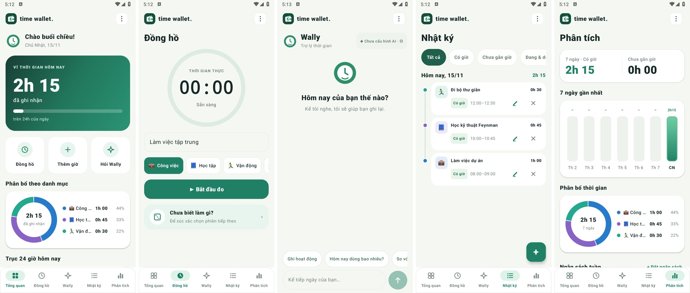

# Ảnh UI thật — Time Wallet / Wally v1.0.11 (LDPlayer, Android 9)

Ảnh chụp màn hình **thật** (`screencap`) của APK candidate v1.0.11 chạy trên instance QA riêng `WallyQA` của LDPlayer 9 (Android 9 / API 28, 780×1688 @320dpi ≈ 390dp). Không phải mô phỏng hay ảnh dựng.

| Mục | Giá trị |
|---|---|
| APK | `TimeWallet-MVP-v1.0.11-WALLY-UIPOLISH-candidate-debug.apk` (không đưa lên git vì `*.apk` bị bỏ qua) |
| SHA-256 | `af50d6cc568633d6f5befad74fce675fc64f17805dc71ab1f042396e1a5079ed` (đã kiểm trước khi cài) |
| Phiên bản | `versionName 1.0.11`, `versionCode 12`, `com.timewallet.mvp` |
| Dữ liệu | **Dữ liệu mẫu của chính app** (nút "Nạp dữ liệu mẫu") + ngân sách Công việc 5h/tuần. Không có khóa AI, không gọi API, không dùng dữ liệu cá nhân |
| Cách chụp | chỉ `adb` + UI Automator + `screencap` (không điều khiển bằng chuột/bàn phím Windows); mỗi tab được chụp sau một lần mở app mới |
| Log | 0 `FATAL EXCEPTION` / `PatternSyntaxException` / ANR của app trong phiên chụp |

## Ảnh có dữ liệu
| Ảnh | Màn hình |
|---|---|
| `01_tong-quan_co-du-lieu.png`, `01b_…cuon-xuong.png` | Tổng quan (thẻ ví, 3 nút nhanh, biểu đồ vòng, trục 24 giờ, ngân sách) |
| `02_dong-ho.png`, `02b_dong-ho_dang-chay.png` | Đồng hồ (sẵn sàng / đang chạy) |
| `03_wally.png` | Wally (màn chào, chưa cấu hình AI) |
| `04_nhat-ky.png` | Nhật ký (timeline theo ngày) |
| `05_phan-tich.png`, `05b_…cuon-xuong.png` | Phân tích (biểu đồ 7 ngày, phân bổ, ngân sách) |
| `06_menu.png`, `07_du-lieu-va-sao-luu.png` | Menu `⋮` và hộp "Dữ liệu & sao lưu" |

## Ảnh trạng thái trống (cài mới)
`fresh_01` … `fresh_05` — 5 tab ngay sau khi cài, chưa có bản ghi nào.

## Phát hiện khi chụp trên LDPlayer (chưa sửa trong commit này)
**Trên instance Android 9 này, thanh tab dưới cùng biến mất ngay khi mở tab Wally** (xem `03_wally.png`, không có thanh tab), dù **không có bàn phím nào đang hiện** (`dumpsys input_method`: `mInputShown=false`). Phím Back thoát hẳn ra launcher, nên từ Wally chỉ rời được bằng cách thoát app rồi mở lại. Nguyên nhân khả dĩ: màn Wally ẩn thanh tab khi `WindowInsets.isImeVisible` là đúng (tính năng mới của v1.0.11) và giá trị này sai trên môi trường này. Trên emulator Android 16 (AVD) thanh tab hiện bình thường. Chưa kiểm trên điện thoại thật. Vì vậy ảnh ở đây chụp mỗi tab từ một lần mở app mới, Wally chụp sau cùng.

Ngoài ra ở 390dp tên danh mục trong chú giải biểu đồ bị cắt ("Công …", "Học t…") — lỗi thẩm mỹ nhỏ.

Chưa có kết quả nào từ điện thoại thật: **không** có `DEVICE_PASS`, `F6_DEVICE_VERIFIED`, `KBD-01`, `AI_LIVE_PASS`, `SPEC_ACCEPTED`.
