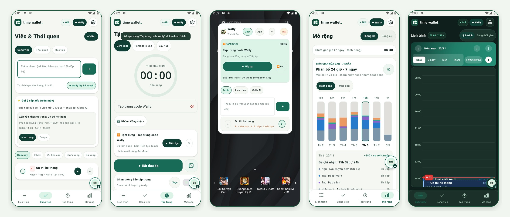

# Thư viện ảnh giao diện thực tế — Time Wallet `v2.2.1` (`versionCode 24`)

Bộ ảnh chụp màn hình thật từ emulator QA tách biệt **`WallyQA`** (`index 1`, Android 9, `780×1688 @320dpi`, múi giờ `Asia/Ho_Chi_Minh`, dữ liệu synthetic — không chạm instance cá nhân của Owner).

## Cập nhật mới trong `v2.2.1` (`D02C4A07…` · `9,457,633` bytes)

| Tệp ảnh | Màn hình / Trạng thái | Điểm kiểm chứng thực tế |
|---|---|---|
| [`v221_01_wally-ke-tu-du-lieu.png`](v221_01_wally-ke-tu-du-lieu.png) | **Thẻ Wally kể từ dữ liệu (mẫu lặp)** | Một phát hiện chính (`2/3 buổi dự kiến "Vận động" tối trùng giờ Công việc kéo dài`) + tối đa 1 hành động khả thi (`Xếp thứ Tư 12:15–12:35`). |
| [`v221_02_phan-tich-va-can-cu.png`](v221_02_phan-tich-va-can-cu.png) | **Modal Phân tích & Căn cứ dữ liệu** | Hiện kỳ so sánh, lý do gợi ý, danh sách 5 ngày/phiên làm căn cứ và nút xếp lịch ngay không cần hỏi lại qua Chat. |
| [`v221_03_nhip-tap-trung_22h30p.png`](v221_03_nhip-tap-trung_22h30p.png) | **Nhịp tập trung & Thống kê mâu thuẫn (`v2.2.1`)** | Không gợi ý khung ban đêm (`07:05–07:20`), hiển thị `22h 30p` thay vì `1350p`, loại phiên `Ngủ` `+48938%` và diễn giải độ lệch `> 300%` bằng phút. |

---

## Tổng hợp nhanh (`v2.2.0` Light, Dark & Trợ lý nổi)

5 màn hình ghép trực tiếp từ ảnh thật: `AI To-do (Light)` · `Tập trung & Tạm dừng nối phiên (Light)` · `Bảng nhanh Wally nổi ngoài màn hình chính` · `Thống kê 24h × 7 ngày (Light)` · `Lịch trình Thực tế vs Dự kiến (Dark)`.

---

## Bộ ảnh mới trong `v2.2.0` (`CB243B22…` · `9,375,715` bytes)

| Tệp ảnh | Màn hình / Trạng thái | Điểm kiểm chứng thực tế |
|---|---|---|
| [`v220_00_gioi-thieu_light.png`](v220_00_gioi-thieu_light.png) | **Onboarding Slide 4 (`v2.2.0`)** | Thông điệp *"Trợ lý thời gian cá nhân giúp bạn học & làm có chủ đích hơn"* cùng giới thiệu Widget, Trợ lý nổi và AI To-do. |
| [`v220_01_lich-trinh-ngay_dark.png`](v220_01_lich-trinh-ngay_dark.png) | **Lịch trình Ngày (Dark Mode)** | Phân biệt rõ hoạt động đang đo thực tế và khối `Dự kiến` (`On thi he thong · 14:15–15:00`) bằng nét đứt trên nền tối. |
| [`v220_02_lich-trinh-tuan_light.png`](v220_02_lich-trinh-tuan_light.png) | **Lịch trình Tuần (`v2.2.0`)** | Tiêu đề `Tuần 23/11–29/11` gọn gàng kèm thanh `Chưa giờ (0)` + `+` cố định. |
| [`v220_03_cong-viec-ai-todo_light.png`](v220_03_cong-viec-ai-todo_light.png) | **AI To-do & Đề xuất chờ duyệt (Light)** | Nhập nhanh ngôn ngữ tự nhiên (`Thêm nhanh`), `✦ Wally lập kế hoạch` gợi ý khung trống `14:15–15:00` kèm nút `✓ Áp dụng / Bỏ qua`. |
| [`v220_04_cong-viec-canh-bao_dark.png`](v220_04_cong-viec-canh-bao_dark.png) | **AI To-do & Cảnh báo hạn (Dark Mode)** | Phát hiện việc gần hạn (`⚠ Lưu ý khối lượng & hạn`) và giữ duy nhất một bóng Wally nổi không trùng lặp. |
| [`v220_05_tap-trung-tam-dung_light.png`](v220_05_tap-trung-tam-dung_light.png) | **Tập trung & Tạm dừng nối phiên** | Tạm dừng ghi đoạn đã đo vào sổ cái (`toast` xác nhận), giữ thẻ `TẠM DỪNG · ▶ Tiếp tục` để nối phiên không mất mạch. |
| [`v220_06_wally-noi-bong-bong.png`](v220_06_wally-noi-bong-bong.png) | **Bóng Wally nổi ngoài màn hình chính** | Mascot Wally gọn nhẹ trên Launcher Android (tùy chọn tắt/bật bất kỳ lúc nào). |
| [`v220_07_wally-noi-bang-nhanh.png`](v220_07_wally-noi-bang-nhanh.png) | **Bảng điều khiển nhanh nổi** | Hiển thị `TẠM DỪNG · ▶ Tiếp tục`, `Sắp làm: 14:15`, thêm/hoàn thành To-do, xem Lịch trình và đóng gọn chỉ với 1 chạm. |
| [`v220_08_wally-noi-chat.png`](v220_08_wally-noi-chat.png) | **Chat nhanh Wally nổi** | Trò chuyện với Wally ngay trên app khác (`Hôm nay làm gì trước?`, `Hôm nay đã ghi gì?`), luôn nhắc quyền xác nhận. |
| [`v220_09_cai-dat_dark.png`](v220_09_cai-dat_dark.png) | **Hồ sơ & Cài đặt `v2.2.0` (Dark)** | Hiển thị `Time Wallet v2.2.0`, chủ đề `Theo máy / Sáng / Tối`, `Cỡ chữ hiển thị`, và bật/tắt module. |

- **Ghi chú kiểm thử thiết bị:** `WallyHomeWidgetProvider` đã được xác minh đăng ký hợp lệ qua `dumpsys appwidget` trên Android 9 (`WallyQA`); do launcher mặc định của giả lập LDPlayer (`com.ldmnq.launcher3`) loại bỏ khay ghim widget của Android (`isRequestPinAppWidgetSupported == false`), ảnh xem trước ngoài launcher chỉ bao gồm bong bóng, bảng nhanh và chat nổi. Toàn bộ logcat `WallyQA` đạt `NO_FATAL_EXCEPTION`.

---

## Bộ ảnh chi tiết các màn Thống kê, Thói quen, Mục tiêu & Lịch mở rộng

36 ảnh chi tiết từ baseline `v2.0.0` (`01`–`33`, cùng bản hợp nhất [`_tong-hop_wally-2.0.jpg`](_tong-hop_wally-2.0.jpg)) vẫn được lưu đầy đủ trong thư mục này để tham chiếu sâu các màn Thống kê 3 lớp (`15_thong-ke-24h_light.png`, `15b_thong-ke-wally-story_light.png`, `26_thong-ke-24h_dark.png`), Thói quen (`08_thoi-quen_light.png`), Mục tiêu (`09_muc-tieu_light.png`), Kanban (`10_kanban_light.png`), Ma trận Eisenhower (`10b_ma-tran-eisenhower_light.png`), Ghim Focus Notification (`13_ghim-focus-dang-do.png`) và Xuất Obsidian Markdown (`18_xuat-markdown_obsidian.png`).

*(Baseline sớm hơn `v1.0.11` lưu tại [../ldplayer-android9/README.md](../ldplayer-android9/README.md).)*
