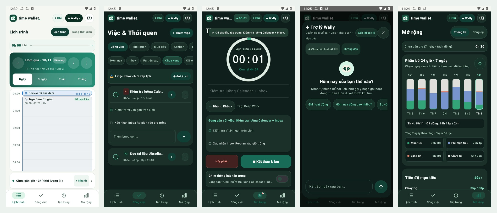

# Ảnh chụp giao diện chuẩn (`ui-preview`) — Time Wallet `v2.0.0` (`versionCode 18`)

Bộ ảnh chụp màn hình được ghi nhận trực tiếp từ **APK Release ký số Production Candidate (`v2.0.0`, `versionCode 18`)** trên môi trường QA tách biệt **`WallyQA`** (`index 1`, `emulator-5556`, Android 9, `780×1688 @320dpi`, múi giờ `Asia/Ho_Chi_Minh`) với dữ liệu synthetic `mock_1week_v200_qa.json` (và kiểm thử nâng cấp tại chỗ từ `v1.2.0` Release `7D703385…`). Không chạm instance cá nhân của Owner (`index 0`).

- **Bản APK cuối cùng đã kiểm chứng (`50EBDFFF…`):** `TimeWallet-MVP-v2.0.0-PRODUCTION-CANDIDATE-release.apk` (`8,993,385` bytes, SHA-256 `50EBDFFF04A9F57C2AFDC4899E4C83CB962374ABF61CDB130B9FE1560EA8A884`). Các ảnh đánh dấu `(v2.0.0 50EBDFFF)` chụp trực tiếp trên APK cuối; các ảnh màn hình phụ không thay đổi ở đợt sửa cuối chụp trên các candidate cùng dòng `v2.0.0` (`19475169…` / `A5BEDBD1…`), được chú thích minh bạch từng dòng bên dưới.
- **Dọn môi trường QA:** Đã xác minh `FATAL EXCEPTION = 0` trong `logcat`, khôi phục `persist.sys.timezone = Asia/Ho_Chi_Minh`, `pm clear com.timewallet.mvp`, xóa tệp QA trên emulator và tắt `WallyQA` (`ldconsole quit --index 1`).
- **Trạng thái chưa kiểm thử runtime (`NOT_TESTED`):** Live AI gọi API thật trên `v2.0.0` (chỉ kiểm chứng khối lọc/chặn offline), khởi động lại lạnh `BOOT_COMPLETED`, Android 13–16 AVD (Rule 14 AEHD), và thiết bị thật của Owner. *(Chi tiết xem [WALLY_V200_CANDIDATE.md](../../../WALLY_V200_CANDIDATE.md); ảnh baseline `v1.0.11` giữ tại [../ldplayer-android9/README.md](../ldplayer-android9/README.md).)*

## Ảnh tổng hợp 5 màn hình nổi bật (`Wally 2.0` Light + Dark)

## Danh sách 34 ảnh chi tiết

| Tệp ảnh | Bản chụp | Màn hình / Luồng nghiệp vụ | Điểm nhấn đã kiểm chứng |
|---|---|---|---|
| [`01_lich-trinh-hom-nay_light.png`](01_lich-trinh-hom-nay_light.png) | `50EBDFFF` | **Lịch trình Ngày (Hôm nay · Light)** | Thanh Ví 24h thu gọn 1 dòng, tiêu đề ngày đầy đủ không cắt chữ, Timeline chiếm trọng tâm. |
| [`02_lich-trinh-ngay_light.png`](02_lich-trinh-ngay_light.png) | `50EBDFFF` | **Lịch trình Ngày (`18/11` · `Hôm nay` pill)** | Nút pill `Hôm nay` rõ nét cạnh ngày, bản ghi xuyên đêm `UC-15` và khay `Chưa gắn giờ`. |
| [`03_lich-trinh-3ngay_light.png`](03_lich-trinh-3ngay_light.png) | `50EBDFFF` | **Lịch trình 3 ngày (`18/11–20/11`)** | So sánh 3 cột kèm tổng giờ thực tế & dự kiến từng ngày, vạch giờ hiện tại. |
| [`04_lich-trinh-tuan_light.png`](04_lich-trinh-tuan_light.png) | `50EBDFFF` | **Lịch trình Tuần (`T2–CN`)** | Đủ 7 cột `16/11–22/11`, tổng hợp giờ từng ngày và badge danh mục. |
| [`05_lich-trinh-thang_light.png`](05_lich-trinh-thang_light.png) | `50EBDFFF` | **Lịch trình Tháng (`11/2026`)** | Tổng quan tháng hiện ngày `Trống`, `KH 3h30p`, chấm cam chờ xác nhận. |
| [`06_lich-trinh-menu_light.png`](06_lich-trinh-menu_light.png) | `50EBDFFF` | **Menu `⋮` điều khiển Lịch** | Gom `＋ Ghi mới hoạt động`, `Tìm & lọc danh mục`, `Hiện chú giải 4 trạng thái` gọn vào menu ngữ cảnh. |
| [`07_cong-viec_light.png`](07_cong-viec_light.png) | `A5BEDBD1` | **Công việc & Inbox (Light)** | Banner Inbox 1 dòng, thẻ Task rút gọn dễ quét (`P1/P2`, nút `▶` Focus 1 chạm, menu `⋯`). |
| [`08_thoi-quen_light.png`](08_thoi-quen_light.png) | `A5BEDBD1` | **Thói quen (`Habits` · Light)** | Tóm tắt `1/1`, tự khớp từ Sổ cái (`⚡`), nhãn `T5..T4` dưới 7 chấm và gợi ý thói quen lành mạnh. |
| [`09_muc-tieu_light.png`](09_muc-tieu_light.png) | `19475169` | **Mục tiêu hợp nhất (`MIN`/`MAX`)** | Hợp nhất Goal tối thiểu theo ngày & Ngân sách tuần tối đa trong 1 danh sách thống nhất. |
| [`10_kanban_light.png`](10_kanban_light.png) | `19475169` | **Bảng Kanban (`Cần làm / Đang làm`)** | Mô-đun tùy chọn ẩn mặc định, chuyển cột & bấm đo Focus trực tiếp từ thẻ. |
| [`10b_ma-tran-eisenhower_light.png`](10b_ma-tran-eisenhower_light.png) | `19475169` | **Ma trận Eisenhower (`Q1–Q4`)** | Phân nhóm theo mức Gấp & Quan trọng với thao tác đo nhanh từng việc. |
| [`11_tap-trung_light.png`](11_tap-trung_light.png) | `A5BEDBD1` | **Tập trung (`Stopwatch / Pomodoro` · Light)** | Bộ đếm kép, xúc xắc gợi ý, công tắc `Ghim tập trung`, không còn nút nổi che giao diện. |
| [`12_ghim-focus-cho.png`](12_ghim-focus-cho.png) | `A5BEDBD1` | **Ghim Focus Notification (Chờ)** | Kiểm chứng độc lập notification `id=910301` kênh `time_wallet_focus_pin` và nút `BỎ GHIM`. |
| [`13_ghim-focus-dang-do.png`](13_ghim-focus-dang-do.png) | `A5BEDBD1` | **Ghim Focus Notification (Đang đo)** | Cập nhật tiêu đề `Đang tập trung: QA_Focus · Công việc · Bắt đầu lúc 23:10` theo phiên đang chạy. |
| [`14_ghi-nhanh-offline_light.png`](14_ghi-nhanh-offline_light.png) | `19475169` | **Thu thập nhanh (`+ Ghi` Offline)** | Nhận diện `"Doc sach 20 phut"` thành `Ghi thời lượng (20p) · Học tập`, không tự bịa mốc giờ. |
| [`15_thong-ke-24h_light.png`](15_thong-ke-24h_light.png) | `A5BEDBD1` | **Thống kê 24h (`7 ngày · 4 tầng`)** | Biểu đồ 4 tầng `Mục tiêu · Phi mục tiêu · Lãng phí · Chưa rõ`, tách riêng `Chưa gắn giờ`. |
| [`16_cong-cu_light.png`](16_cong-cu_light.png) | `A5BEDBD1` | **Mở rộng › Công cụ** | Tách rõ không gian Công cụ năng suất khỏi Cài đặt, nối trực tiếp Ghim Focus & Xuất Markdown. |
| [`17_cai-dat_light.png`](17_cai-dat_light.png) | `A5BEDBD1` | **Hồ sơ & Cài đặt (Light)** | Gom `Giao diện & Module`, `Quyền đọc dữ liệu AI`, `Quy tắc cục bộ`, `Dữ liệu JSON`. |
| [`18_xuat-markdown_obsidian.png`](18_xuat-markdown_obsidian.png) | `19475169` | **Xuất Markdown (Obsidian)** | Sinh báo cáo thuần cục bộ theo ngày để sao chép hoặc chia sẻ sang kho ghi chú cá nhân. |
| [`19_lich-trinh-tuan_dark.png`](19_lich-trinh-tuan_dark.png) | `50EBDFFF` | **Lịch trình Tuần (Dark Mode)** | Tiêu đề `Tuần 16/11 – 22/11` trọn vẹn, tương phản rõ trên nền tối `#0F1A15`. |
| [`20_chon-gio-trong_dark.png`](20_chon-gio-trong_dark.png) | `19475169` | **Chọn khung giờ trống (Dark Mode)** | Thẻ `Đã chọn 1 khối giờ trống`, nút `Bỏ` và `+ Tạo sự kiện` tương phản cao trên nền tối. |
| [`21_cong-viec-subtasks_dark.png`](21_cong-viec-subtasks_dark.png) | `50EBDFFF` | **Công việc & Checklist Subtasks (Dark Mode)** | Chạm thẻ mở nhanh các bước con (`1/2 bước`) và thêm bước mới tại chỗ. |
| [`22_tap-trung-task_dark.png`](22_tap-trung-task_dark.png) | `50EBDFFF` | **Tập trung gắn Task & Subtasks (Dark Mode)** | Nạp thẳng mục tiêu 45p, Tag `Deep Work` và danh sách Subtasks ngay dưới đồng hồ đang chạy. |
| [`23_da-xong-viec-dialog_dark.png`](23_da-xong-viec-dialog_dark.png) | `50EBDFFF` | **Hộp thoại `"Đã xong công việc!"` (Dark)** | Xác minh `WalletCardBg` tối và chữ trắng sắc nét thay cho nền trắng trước đó. |
| [`24_wally-overlay_dark.png`](24_wally-overlay_dark.png) | `19475169` | **Wally Pop-on Overlay (Dark Mode)** | Trải nghiệm hội thoại tự nhiên qua nút `✦ Wally`, không còn hàng nút gợi ý lặp lại. |
| [`25_wally-chan-quyen-ai_dark.png`](25_wally-chan-quyen-ai_dark.png) | `50EBDFFF` | **Chặn Quyền đọc Công việc AI (Dark Mode)** | Khi tắt quyền `Công việc & Inbox`, bấm `Xếp Inbox (1)` bị chặn cục bộ tức thì, 0 dữ liệu việc rò rỉ. |
| [`26_thong-ke-24h_dark.png`](26_thong-ke-24h_dark.png) | `19475169` | **Thống kê 24h & Tiến độ mục tiêu (Dark)** | Nhãn `Sửa ›` màu mint sáng rõ ràng, các tầng dữ liệu tương phản tốt. |
| [`27_cai-dat_dark.png`](27_cai-dat_dark.png) | `19475169` | **Hồ sơ & Cài đặt (Dark Mode)** | Chuyển nhanh chủ đề `Theo máy / Sáng / Tối` và bật tắt các module mở rộng. |
| [`28_nhap-json_dark.png`](28_nhap-json_dark.png) | `50EBDFFF` | **Hộp thoại Nhập & khôi phục JSON (Dark)** | Chữ, khung nhập và 2 nút `Gộp an toàn / Khôi phục toàn bộ` hiển thị đồng nhất trên nền tối. |
| [`29_xac-nhan-gio-dialog_dark.png`](29_xac-nhan-gio-dialog_dark.png) | `19475169` | **Đối soát kết thúc giờ (Dark Mode)** | Màn `Đã tới giờ xác nhận` với đủ 5 nhánh hoàn thành/điều chỉnh/gián đoạn/kéo dài/hủy. |
| [`30_thoi-quen_dark.png`](30_thoi-quen_dark.png) | `19475169` | **Thói quen (Dark Mode)** | Chuỗi 7 ngày và chip gợi ý cân đối trên nền tối. |
| [`31_muc-tieu_dark.png`](31_muc-tieu_dark.png) | `19475169` | **Mục tiêu hợp nhất (Dark Mode)** | Cảnh báo vượt ngân sách tuần và mục tiêu tối thiểu ngày rõ nét. |
| [`32_kanban_dark.png`](32_kanban_dark.png) | `19475169` | **Bảng Kanban (Dark Mode)** | Các cột và thao tác chuyển trạng thái giữ nguyên độ đọc trong chế độ tối. |
| [`33_ma-tran-eisenhower_dark.png`](33_ma-tran-eisenhower_dark.png) | `19475169` | **Ma trận Eisenhower (Dark Mode)** | Viền nhóm Q1–Q4 phân tách rõ trên nền card tối. |
