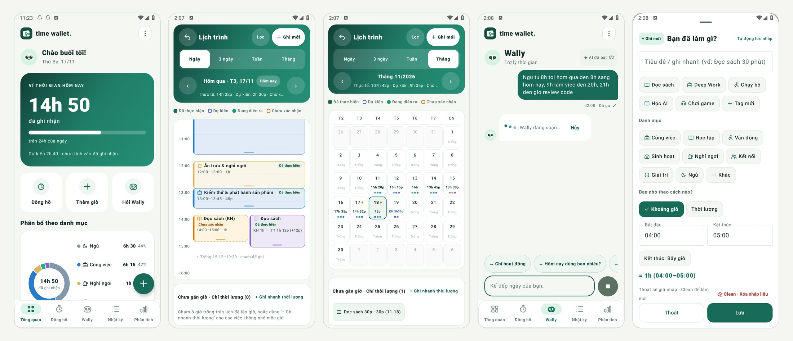

# Ảnh chụp giao diện chuẩn (`ui-preview`) — Time Wallet `v1.2.0` Production Candidate

Bộ ảnh chụp màn hình mới được thực hiện trực tiếp trên **APK Release ký số Production Candidate (`v1.2.0`, `versionCode 16`)** cài trên môi trường QA tách biệt **`WallyQA`** với bộ dữ liệu mock synthetic **1 tuần (11/11 → 17/11/2026)** và kết nối AI thật (dữ liệu tổng hợp + khóa QA tạm, đã xóa khóa khỏi thiết bị ngay sau khi chụp).

- **Thiết bị & môi trường QA:** LDPlayer 9 `WallyQA` (`index 1`, `emulator-5556`), Android 9, độ phân giải `780×1688 @320dpi` (`~390dp`), múi giờ `Asia/Ho_Chi_Minh`.
- **APK lúc chụp bộ ảnh mới (`03a`, `03d`, `04c`, `04d`, `06*`, `_tong-hop_5-man-hinh.jpg`):** Release `TimeWallet-MVP-v1.2.0-PRODUCTION-CANDIDATE-release.apk` (`8,682,089` bytes, SHA-256 `7D703385B64F8CB40B6472352C4AD3572E03EBBE1CB503FF67750BD90B20D274`, `versionCode=16`); các ảnh nền v3 (`01*`, `02`, `03`, `03b`, `03c`, `04`, `04b`, `05*`, `07..10`) chụp từ bản Release `AC224463…` trong cùng chuỗi `v1.2.0`. Toàn bộ đều là dữ liệu synthetic QA; không chạm instance cá nhân của Owner (`index 0`). *(Chi tiết bảng PASS / `NOT_TESTED` tại [WALLY_V120_PRODUCTION_CANDIDATE.md](../../../WALLY_V120_PRODUCTION_CANDIDATE.md).)*
- **Dữ liệu mock 1 tuần mở rộng:** Nạp `47` bản ghi synthetic (`11/11–19/11/2026`, bổ sung cặp đối chiếu Kế hoạch `60p` vs Thực tế `72p` ngày 17/11, vắt nửa đêm `UC-15`, `Chưa xác nhận`, `Dự kiến` và `Chưa gắn giờ`) qua **`Nhập / khôi phục JSON`** (`Khôi phục toàn bộ`). *(Thư mục `out/` và `feedback/` được loại trừ khỏi Git theo `.gitignore`.)*
- **Logcat & live AI sau phiên chụp cuối:** `FATAL EXCEPTION = 0`; live AI trả HTTP `200`, tự dọn ô nhập khi gửi, giữ lịch sử qua `am force-stop`; đã xóa sạch dữ liệu/khóa QA (`pm clear`) và tắt `WallyQA`.
- **Trạng thái chưa kiểm thử runtime (`NOT_TESTED`):** Khởi động lại lạnh (`BOOT_COMPLETED`) trên `WallyQA`, Android 13–16 AVD (Rule 14 AEHD), và điện thoại thật của Owner.
- **Thư mục lịch sử:** [../ldplayer-android9/README.md](../ldplayer-android9/README.md) giữ nguyên bộ ảnh baseline `v1.0.11` (`versionCode 12`, commit `195a60c`).

## Ảnh tổng hợp 5 màn hình nổi bật (UI Mới + Live AI)

## Danh sách ảnh chi tiết

| Tệp ảnh | Màn hình / Luồng nghiệp vụ | Điểm nhấn giao diện |
|---|---|---|
| [`01_tong-quan.png`](01_tong-quan.png) | **Tổng quan** | Ví thời gian hôm nay (`14h 50` đã ghi nhận + `Dự kiến 2h 40 · chưa tính vào đã ghi nhận`), avatar 2D Wally, 3 nút nhanh v3, Donut 2D dùng icon vector danh mục v3. |
| [`01_tong-quan_donut_pop.png`](01_tong-quan_donut_pop.png) | **Donut 2D tương tác** | Chạm dòng `Ngủ` đẩy lát nổi 2D, tô viền dòng chú giải tương ứng và hiện `6h 30 / Ngủ · 44%` ở tâm. |
| [`01b_wally-coach-ai.png`](01b_wally-coach-ai.png) | **Wally Coach AI (`7 ngày qua`)** | Live `cinb/claude-sonnet-4-6` (`wally-coach-5`): avatar 2D v3, headline 1 câu, bullet highlight, hộp `Lưu ý:`, Action Item (`Lên lịch →`) và cụm FAB nổi. |
| [`01c_speed-dial.png`](01c_speed-dial.png) | **Speed Dial thao tác nhanh** | Mở từ FAB `+` góc dưới phải với 3 nhãn rõ ràng (`Nhìn lại ngày hôm nay`, `Bắt đầu đồng hồ`, `Ghi giờ thủ công`). |
| [`02_dong-ho.png`](02_dong-ho.png) | **Đồng hồ** | Tab đang chọn dùng `ic_nav_timer_pressed` (kim trắng trên nền Mint sắc nét), chip danh mục/Tag vector (`Học AI`, `Deep Work`, `Đọc sách`), `▶ Bắt đầu đo` và thẻ `Dopamine Time Dice`. |
| [`03_wally.png`](03_wally.png) | **Wally Chat & Trả lời `✦`** | Bong bóng gửi canh phải có đuôi + `"23:28 · Wally đã xem ✓✓"`, thẻ trả lời `✦ Wally (AI)` canh trái có vạch nhấn + danh sách so sánh tuần & avatar 2D. |
| [`03a_wally-typing.png`](03a_wally-typing.png) | **Chỉ báo đang soạn & dọn ô nhập** | Bong bóng đã gửi + tự dọn chữ khỏi ô nhập (`"Kể tiếp ngày của bạn..."`) trong khi 3 chấm `Wally đang soạn...` hiển thị + nút `Hủy`. |
| [`03b_wally-proposals.png`](03b_wally-proposals.png) | **Wally AI (Đa đề xuất)** | Trạng thái `✦ AI đã bật · ⚙`, bóc tách câu tiếng Việt thành **5 thẻ đề xuất** kèm 5 `CategoryBadge` vector và nút `✓ Xác nhận toàn bộ (5 hoạt động)`. |
| [`03c_wally-welcome.png`](03c_wally-welcome.png) | **Wally Welcome (Hero chi tiết)** | Hiển thị `ic_wally.webp` (`512×512` xuất từ `Wally_Vector_Detailed.svg`) nền trong suốt hoàn toàn trên `ChatScreen`, không tạo ô nền xanh lệch màu. |
| [`03d_wally-history-persisted.png`](03d_wally-history-persisted.png) | **Lịch sử chat bền vững (`force-stop`)** | Sau khi tắt cưỡng bức app và mở lại, tin nhắn và nút `Xóa lịch sử` vẫn được khôi phục nguyên vẹn. |
| [`04_nhat-ky.png`](04_nhat-ky.png) | **Nhật ký (Sáng → Chiều)** | Timeline `Hôm nay, 17/11` (`14h 50`, `+6h 30` xuyên đêm), `CategoryBadge` vector, icon thùng rác `Delete` đỏ tách biệt, thẻ `Đã đo` / `Có giờ` / `Khoảng nghỉ`. |
| [`04b_nhat-ky-doing-planned.png`](04b_nhat-ky-doing-planned.png) | **Timeline chờ xác nhận & `±15p`** | Thẻ `19:45` / `21:15` chờ xác nhận kết quả, nút `✓ Xác nhận kết quả` & icon `Delete`, và tay cầm `↔ Kéo giãn nhanh ±15p`. |
| [`04c_nhat-ky-lich-trinh.png`](04c_nhat-ky-lich-trinh.png) | **Nhật ký `Lịch trình \| Dòng thời gian`** | Nút chuyển nhanh ngay đầu tab Nhật ký giữa lưới Lịch trình và Dòng thời gian. |
| [`04d_sua-hoat-dong.png`](04d_sua-hoat-dong.png) | **Chỉnh sửa hoạt động & Đối soát** | Hộp thoại `EditRecordDialog` kèm icon Xóa đỏ góc phải, cảnh báo tách biệt Kế hoạch vs Thực tế và nút xác nhận kết quả. |
| [`05_phan-tich.png`](05_phan-tich.png) | **Phân tích (`7 ngày gần nhất`)** | Tổng tuần `106h 15` (`7 ngày · Có giờ`), khử trùng song song `1h 00`, đủ **7 cột `Th 4` → `Th 3`**. |
| [`05b_phan-tich-budgets-dnd.png`](05b_phan-tich-budgets-dnd.png) | **Ngân sách Kéo-Thả** | Thẻ `Ngân sách tuần` dùng `CategoryBadge` vector + thùng rác `Delete`, tay cầm `⋮⋮` (`detectDragGestures`) và nhãn `★ Ưu tiên`. |
| [`06a_lich-trinh-ngay.png`](06a_lich-trinh-ngay.png) | **Lịch trình Ngày (`Kế hoạch vs Thực tế`)** | Header xanh 4 chế độ, nút `Hôm nay`, đối chiếu song song `Đọc sách (KH)` 60p vs `Đọc sách` 72p (`KH 1h -> TT 1h 12p (+12p)`), gợi ý `+ Trống 15:12–19:30`. |
| [`06b_lich-trinh-3ngay.png`](06b_lich-trinh-3ngay.png) | **Lịch trình 3 ngày** | So sánh `17/11 – 19/11`: xuyên đêm `UC-15`, vạch giờ đỏ hôm nay, thẻ `Chưa xác nhận`. |
| [`06c_lich-trinh-tuan.png`](06c_lich-trinh-tuan.png) | **Lịch trình Tuần (`7 cột`)** | Phân bổ toàn tuần `T2–CN`, tóm tắt giờ mỗi ngày, không đưa bản ghi chưa gắn giờ lên lưới. |
| [`06d_lich-trinh-thang.png`](06d_lich-trinh-thang.png) | **Lịch trình Tháng (`Ngày trống` & `KH`)** | Tổng quan tháng đánh dấu ngày `Trống`, `KH 3h30p`, chấm cam chờ xác nhận, khay tách riêng `Chưa gắn giờ · Chỉ thời lượng`. |
| [`06_nhap-gio_manual.png`](06_nhap-gio_manual.png) | **Thêm giờ (`+ Ghi mới` từ khoảng trống)** | Mở từ ô trống lịch với sẵn khung `04:00–05:00`, ô `Tiêu đề / ghi nhanh` ở đầu form, footer cố định (`Clean`, `Thoát`, `Lưu`). |
| [`06e_ghi-nhanh-khong-gio.png`](06e_ghi-nhanh-khong-gio.png) | **Ghi nhanh `"Doc sach 30 phut"` -> `Áp nhanh`** | Tự nhận Tag `Đọc sách` + nhóm `Học tập` + `Thời lượng 30p`, tuyệt đối không bịa giờ bắt đầu/kết thúc. |
| [`07_xu-ly-chong-lan.png`](07_xu-ly-chong-lan.png) | **Xử lý hoạt động xen giữa (`OverlapResolutionDialog`)** | Phát hiện chồng lấn với các lựa chọn tách khoảng nghỉ, chạy song song, chỉnh giờ hoặc để sau. *(ảnh preview v1.2.0)* |
| [`08_xac-nhan-trang-thai.png`](08_xac-nhan-trang-thai.png) | **Xác nhận trạng thái (`ActivityConfirmationDialog`)** | Đối soát hoàn thành, điều chỉnh, dừng sớm hoặc hủy hoạt động dự kiến. *(ảnh preview v1.2.0)* |
| [`09_ban-nhap_tong-quan.png`](09_ban-nhap_tong-quan.png) | **Bản nháp đang nhập dở trên Tổng quan** | Thẻ khôi phục bản nháp tự lưu trên Tổng quan kèm nút `Clean · Xóa nháp`. *(ảnh preview v1.2.0)* |
| [`10_nhap-json_release.png`](10_nhap-json_release.png) | **Nhập & khôi phục dữ liệu (JSON)** | Hộp thoại `ImportJsonDialog` trên bản Release chọn chế độ `Gộp an toàn` / `Khôi phục toàn bộ`, không ghi đè khóa AI. |
